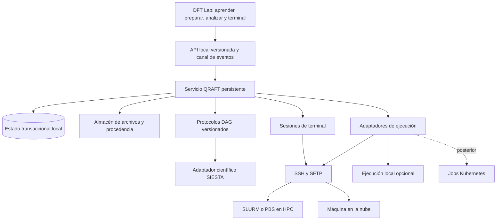

# Evaluación de arquitectura: DFT Lab + QRAFT-HPC + HubbardFlow

Fecha: 10 de octubre de 2026.

**Actualización tras identificar los motores externos:** se revisaron QRAFT HPC en `4d996ea7c580e5638e470bbf32624c88fd762f7d` y HubbardFlow en `e508f47aff1c6243deabb12915063b6b9d899d65`. La recomendación actual es reutilizarlos mediante un adaptador versionado. Los detalles, límites y pruebas están en [INTEGRACION_DFTLAB_QRAFT_HUBBARDFLOW.md](C:/Users/Jairo/Downloads/DFTQUANTUMLAB/DFT_App_completo/INTEGRACION_DFTLAB_QRAFT_HUBBARDFLOW.md). Los fallos de la tabla siguiente se refieren a la especificación pegada, no se atribuyen automáticamente a esos motores.

**Dictamen:** la visión tiene sentido y puede dar lugar a una plataforma científica sólida. La especificación propuesta necesita correcciones antes de convertirse en un plan de implementación: contiene errores en el protocolo Hubbard, heurísticas físicas demasiado generales y garantías de recuperación que la arquitectura descrita todavía no puede cumplir. Recomiendo comenzar con una aplicación local y un servicio persistente, conectados por SSH a máquinas en la nube y schedulers HPC. La futura interfaz web debe reutilizar esos contratos.

Esta evaluación combina el repositorio, la propuesta adjunta y documentación primaria. Distingue capacidades existentes de decisiones recomendadas. No implementa el puente, los DAG ni nuevos cálculos SIESTA. Las verificaciones del código actual están documentadas en [ANALISIS_TECNICO.md](C:/Users/Jairo/Downloads/DFTQUANTUMLAB/DFT_App_completo/ANALISIS_TECNICO.md).

## 1. Utilidad y límites del producto

Comprendo la herramienta como un entorno que conecta **aprendizaje, preparación de cálculos, ejecución externa, análisis y reproducibilidad**. Una misma estructura puede pasar de ejemplo didáctico a entrada científica, campaña remota y resultado publicable, conservando su procedencia.

La base actual contiene una interfaz modular empaquetada en un HTML, lectores SIESTA, cristalografía, generación de entradas y análisis numérico. El navegador no ejecuta SIESTA; sí ejecuta algoritmos propios de análisis y física. El servicio de ejecución remota y el motor de campañas aún no existen.

Hay dos correcciones de inventario en la propuesta: existen 15 capítulos educativos; la biblioteca reúne 30 elementos con variantes LDA/PBE, es decir, 60 archivos de pseudopotenciales. QRAFT y HubbardFlow no están integrados en esta copia de DFT Lab, pero el usuario identificó después sus repositorios externos y se verificó que contienen implementación real. Sus versiones y responsabilidades quedan recogidas en el informe de integración.

El HTML único es una modalidad de distribución válida. Recomiendo conservarlo para enseñanza y análisis portátil, y añadir una distribución operativa servida por el servicio local. El diseño modular de la fuente permite ambas salidas.

## 2. Qué conservar y qué corregir

Conservaría la separación `learn / tools / post / remote`, los lectores existentes, los presets de corridas simples, la distinción guiado/experto, la terminal SSH y los cuatro protocolos iniciales. También conservaría la posibilidad de exportar paquetes para ejecutar fuera de la plataforma.

| Prioridad | Problema de la especificación | Consecuencia | Corrección recomendada |
|---|---|---|---|
| Crítica | HubbardFlow exige invariancia estricta de los autovalores de ocupación | Anula la variación de ocupaciones necesaria para medir la respuesta | Comprobar continuidad de la rama electrónica y linealidad |
| Alta | Un sitio perturbado y ocho corridas se presentan como solución general para U | Pueden faltar columnas de las matrices de respuesta | Enumerar sitios inequivalentes y justificar toda reconstrucción por simetría |
| Alta | `manifest.json` compartido por nodos paralelos, protegido solo con `fsync` | Actualizaciones perdidas y estado inconsistente | Escritor canónico transaccional; resultados por intento |
| Alta | Reanudar omitiendo todos los nodos `COMPLETED` | Reutilización de resultados obsoletos o incompatibles | Verificar huellas, dependencias, integridad y calidad |
| Alta | PID como identidad del trabajo | Identidad insuficiente al desconectarse o cambiar de nodo | ID del scheduler, clúster e intento UUID |
| Alta | Corte eléctrico inferido de un archivo truncado; OOM de cualquier `SIGSEGV` | Diagnósticos falsos y recomendaciones perjudiciales | Evidencia del scheduler y diagnóstico con incertidumbre |
| Alta | Bajar malla o base como recuperación automática de OOM | Cambia el modelo numérico dentro de una campaña | Ajustar recursos; cambios científicos crean una nueva revisión |
| Alta | Puente local considerado seguro por escuchar en loopback | Una página o archivo malicioso podría activar operaciones remotas | Autenticación, autorización, origen y tratamiento seguro del contenido |
| Alta | Descarga completa de grandes resultados a memoria del navegador | Bloqueos y consumo excesivo de RAM | Transferencias en flujo, almacenamiento local y vistas reducidas |
| Alta | Umbrales universales de 500 Ry, 16 Å y 0.6 Å | Consejos científicos incorrectos para algunos sistemas | Reglas contextuales y convergencia del observable |
| Media | SSH, scheduler y ejecución mezclados en `run(command)` | Difícil sustituir SLURM/PBS o migrar a web | Adaptadores separados y operaciones estructuradas |
| Media | Contrato remoto sustituido por una sesión singleton con credenciales | Rompe el contrato existente y limita varios hosts | `connect(profile) → Session`; credenciales gestionadas por el servicio |
| Media | Kubernetes sidecar y controlador de Jobs sin responsabilidades claras | Dos mecanismos de ejecución y aislamiento incompleto | Kubernetes como backend opcional de ejecución |
| Media | Gates de EOS, bandas y superficie insuficientemente definidos | Resultados plausibles con validez científica no demostrada | Criterios verificables específicos de cada protocolo |

Estas prioridades corresponden al diseño propuesto. Los defectos actuales de navegación, calculadora y postproceso están detallados por separado en la revisión del repositorio.

## 3. Arquitectura recomendada para tu primer despliegue

**DFT Lab** sería el entorno de interacción, aprendizaje y análisis. **QRAFT-HPC** gestionaría campañas, intentos, recursos, ejecución, recuperación y procedencia. **HubbardFlow** sería un protocolo científico versionado dentro del sistema, con sus entradas, salidas y criterios de validación.

Comenzaría con un **servicio Python modular**, no con una red de microservicios. FastAPI y un servidor ASGI pueden atender HTTP y WebSocket; AsyncSSH gestiona SSH/SFTP. No hace falta combinar varios servidores equivalentes sin una necesidad concreta.

Separaría internamente `api`, `domain`, `workflows`, `engines`, `transports`, `schedulers`, `storage` y `analysis`. Los módulos se comunican mediante contratos explícitos. La UI recibe resultados y eventos; la ejecución del DAG vive en el servicio y continúa al cerrar una pestaña.

La terminal mantiene su función interactiva. Los DAG usan operaciones estructuradas: `submit`, `poll`, `cancel`, `collect`, `validate`. El adaptador traduce estas operaciones a cada scheduler. Los comandos escritos manualmente en la terminal son acciones del usuario; conviene registrar cuándo una intervención modifica un directorio de campaña.

Cada perfil de sitio debe describir host, salto SSH, scheduler, cuenta, partición/cola, rutas de trabajo, módulos, ejecutable, capacidades y límites. SSH es el transporte; SLURM/PBS decide dónde y cuándo corre un trabajo. Una VM conectada por SSH puede usar un ejecutor remoto sin scheduler, con persistencia explícita del proceso.

Los recursos deben expresarse como nodos, ranks MPI, threads por rank y memoria, y contrastarse con la asignación y el ejecutable. Lanzar muchos ranks de un binario `nompi` no lo convierte en un cálculo distribuido: puede iniciar copias independientes que compiten por las mismas salidas. El perfil debe rechazar esa configuración y generar el launcher adecuado al sitio.

Para contenedores HPC, el perfil debe permitir ejecución nativa mediante módulos o Apptainer. MPI exige compatibilidad con la instalación y el entorno del clúster; una imagen con OpenMPI no garantiza funcionamiento en cualquier sitio. [Documentación de Apptainer sobre MPI](https://apptainer.org/docs/user/latest/mpi.html).

En Windows debe probarse el empaquetado del servicio, el acceso al agente SSH y la resolución de configuración. Si más adelante se ofrece cálculo local, se debe declarar qué runtime usa: instalación nativa disponible, WSL u otro entorno compatible. La interfaz local y el lugar donde corre SIESTA son decisiones independientes.

### Laptop apagada y campañas adaptativas

Cerrar la UI no debe detener el servicio. Apagar la laptop sí detiene un controlador alojado exclusivamente allí. Los trabajos ya aceptados por el scheduler pueden continuar; las decisiones futuras de un DAG adaptativo necesitan un controlador activo.

Recomiendo dos modalidades explícitas:

- **Campaña autónoma exportada:** subgrafo conocido enviado al scheduler, con dependencias y validadores ejecutados como trabajos. Puede continuar sin la laptop.
- **Campaña adaptativa supervisada:** QRAFT decide nuevos nodos según resultados. Si se requiere continuidad sin la laptop, su controlador debe residir en un entorno remoto permitido por el sitio.

No asumiría permiso para mantener un daemon de cálculo en un nodo de login. Tras reconectar, QRAFT consulta al scheduler y reconcilia el estado antes de enviar nada nuevo.

## 4. Contratos que harán posible la flexibilidad

| Entidad | Información mínima |
|---|---|
| `Structure` | Celda, posiciones, unidades, periodicidad, identidad estable de átomos y transformaciones |
| `Species` | Elemento, etiqueta, pseudo y su hash, base y asociación a átomos |
| `PhysicalModel` | Funcional, carga, espín, tratamiento relativista, Hubbard y proyectores |
| `Numerics` | Base, mallas, smearing, tolerancias, solver y criterios de convergencia |
| `RunSpec` | Modelo, estructura, entradas resueltas, motor y recursos solicitados |
| `WorkflowSpec` | Versión del protocolo, nodos, tipos de archivos, dependencias y gates |
| `Attempt` | UUID, identidad remota, tiempos, recursos, estado y motivo de terminación |
| `Artifact` | Tipo, ubicación, tamaño, hash, productor, versión de formato y política de conservación |
| `QualityReport` | Evidencia, tolerancias, advertencias, incertidumbre y ámbito de validez |

Los esquemas deben versionarse. JSON Schema/Pydantic pueden ayudar a mantener alineadas API y UI, pero validar un esquema no demuestra validez física.

Un nodo declara qué necesita y qué produce. Una arista puede transportar una geometría, una densidad compatible o una tabla validada; no basta con que el nodo padre haya terminado. Las campañas adaptativas crean nuevos nodos identificables. Sus iteraciones quedan desplegadas como historial, con límites de intentos y recursos.

No abstraería todos los motores a un conjunto mínimo que borre sus diferencias. Recomiendo una capa común de estructuras, trabajos y archivos, más capacidades específicas por motor. SIESTA debe ser el primer adaptador completo. Otros motores se incorporan cuando sus protocolos y pruebas estén definidos.

## 5. Persistencia, integridad y reanudación

### Estado durable

`fsync` ayuda a la durabilidad, pero no resuelve el caso de dos procesos que leen el mismo manifiesto, cambian nodos diferentes y sobrescriben la actualización del otro. Reemplazar el archivo de forma atómica tampoco resuelve ese conflicto.

QRAFT ya aporta un runtime con journal, intentos y comprobación de evidencia. Esa autoridad debe conservarse. Una base transaccional adicional puede gestionar proyectos, permisos, solicitudes e índices de la plataforma; no reemplazará el runtime ni decidirá por separado qué nodo ejecutar. SQLite es una opción local para esa función; WAL exige procesos en el mismo host y no funciona sobre un filesystem de red. [SQLite WAL](https://sqlite.org/wal.html).

`manifest.json` será una exportación o instantánea recuperable, no el mecanismo compartido de coordinación. Cada intento remoto escribirá resultados en su propio directorio y emitirá un registro de finalización verificable. Los nodos paralelos no compartirán archivos `.DM`, temporales ni salidas escribibles.

Separaría cuatro dimensiones de estado:

- **Scheduler:** pendiente, ejecutando, timeout, cancelado, fallo de nodo, etc.
- **Ejecución:** preparado, enviado, recolectando, finalizado o estado remoto desconocido.
- **Calidad científica:** no evaluada, convergida, no convergida o incumplimiento de un criterio del protocolo.
- **Integridad:** archivos completos, incompletos, ausentes o incompatibles.

SLURM distingue estados como `TIMEOUT`, `OUT_OF_MEMORY`, `NODE_FAIL` y `PREEMPTED`. Deben recogerse junto con sus códigos y registros disponibles; un trabajo terminado no certifica la calidad científica. [Estados de SLURM](https://slurm.schedmd.com/job_state_codes.html).

### Evitar envíos duplicados

Un fallo difícil ocurre cuando el scheduler acepta el trabajo y se pierde la respuesta SSH. Reintentar inmediatamente puede duplicarlo. Recomiendo persistir la intención de envío, incorporar un identificador de intento en metadatos remotos y consultar antes de repetir. Cuando no pueda determinarse qué ocurrió, el estado debe ser ambiguo y requerir resolución.

La identificación incluye clúster, ID del scheduler, UUID de intento y contexto temporal. Un PID aislado es insuficiente. No prometería ejecución exactamente una vez: incluso Kubernetes documenta que un programa de Job puede arrancar más de una vez. El diseño debe tolerar repetición y publicación idempotente de resultados. [Jobs de Kubernetes](https://kubernetes.io/docs/concepts/workloads/controllers/job/).

### Política correcta de reanudación

Reutilizar un nodo requiere coincidencia de la revisión científica, entradas efectivas, versiones relevantes del protocolo/motor y hashes de las dependencias; además, exige archivos íntegros y criterios de calidad satisfechos. El cambio de una dependencia invalida los descendientes afectados.

Cada reintento usa un nuevo directorio. La semilla elegida se copia desde un archivo preservado y se registra su identidad. Una `.DM` sirve como inicio electrónico y una `.XV` puede aportar una geometría; ninguna debe anunciarse como un checkpoint universal del estado completo del algoritmo. `DM.UseSaveDM` tampoco prueba que la densidad se haya leído: SIESTA puede continuar si falta el archivo. [Manual SIESTA 5.4](https://docs.siesta-project.org/projects/siesta/en/5.4/reference/siesta.html).

La recuperación debe verificar compatibilidad de átomos, etiquetas, base, celda, espín y archivos; registrar lo que el motor leyó realmente; y reconstruir los nodos listos según las dependencias. Conservará el paralelismo del DAG.

Cambiar recursos puede dar lugar a otro intento del mismo nodo. Cambiar estructura, base, pseudo o parámetros del protocolo crea una revisión científica y se somete a la política de invalidación correspondiente. Nunca se modifica silenciosamente una campaña para hacer que termine.

### Diagnóstico de fallos

| Evidencia | Diagnóstico admisible | Lo que no demuestra |
|---|---|---|
| Registro explícito de timeout del scheduler | Límite de tiempo alcanzado | Que el cálculo convergía correctamente |
| Registro de OOM | Memoria excedida | Que bajar la precisión sea aceptable |
| `SIGSEGV` | Terminación por acceso inválido a memoria | OOM como causa única |
| Salida truncada | Salida incompleta o interrupción no identificada | Corte eléctrico |
| SCF no convergido | Criterio numérico de autoconsistencia incumplido | Imposibilidad física del sistema |
| Se pierde SSH | Conectividad interrumpida | Que el trabajo haya muerto |

El informe mostrará evidencia, hipótesis y grado de confianza. Si solo hay un paquete de archivos sin registros externos, puede quedar una causa desconocida. No debe recomendar automáticamente bajar base o malla ante OOM: solicitar recursos o cambiar paralelismo es una primera opción; cambiar precisión requiere una nueva decisión científica.

## 6. Puente, terminal y archivos

Antes de añadir autoridad SSH, deben cerrarse los puntos de inserción de HTML desde archivos ya reproducidos en el repositorio. Un archivo de resultados es contenido no confiable. Si consigue ejecutar JavaScript en una sesión operativa, puede usar la autoridad del puente aunque la clave SSH nunca se envíe al navegador.

Recomiendo autenticación para toda operación sensible, validación explícita de `Origin` y `Host`, protección CSRF en HTTP y autorización de los canales WebSocket. Los tokens en query strings pueden aparecer en logs; conviene un mecanismo de arranque de un solo uso que establezca una sesión protegida. Los canales necesitan límites y control de flujo. [Seguridad WebSocket de OWASP](https://cheatsheetseries.owasp.org/cheatsheets/WebSocket_Security_Cheat_Sheet.html).

La UI operativa se servirá desde un origen local definido. El HTML abierto por `file://` conserva su uso portátil; no debe habilitarse una autorización general para cualquier origen `null`.

Mantendría el contrato `connect(profile) → Session`, con varias sesiones independientes, IDs y capacidades. El servicio resuelve agente, configuración y credenciales. Debe comprobarse la identidad del host mediante `known_hosts`; no desactivar esa verificación para facilitar la conexión. [AsyncSSH](https://asyncssh.readthedocs.io/en/stable/index.html).

Para archivos grandes, el servicio recibe o transmite en flujo, conserva una copia local y ofrece al navegador datos reducidos para visualización. La transferencia debe permitir progreso, cancelación, reanudación y comprobación de integridad. Una `.DM`, `.RHO` o colección comprimida puede superar ampliamente el tamaño del HTML.

La subida usa staging, verificación y publicación mediante renombrado donde el filesystem lo permita. Toda ruta se resuelve dentro del directorio autorizado del intento. La ingestión de archivos comprimidos limita tamaño expandido y número de entradas, y controla rutas absolutas, `..` y enlaces. Estas reglas protegen tanto la laptop como el directorio remoto de campaña.

Para la salida operativa, recomiendo activos servidos con una política CSP coherente y dependencias locales. El bundle portátil seguirá siendo una salida independiente. Las credenciales del servicio web futuro deberán asociarse a identidades y permisos de cada usuario.

## 7. Preflight: rigor con flexibilidad

QRAFT ya incluye parser, materialización de entradas efectivas y validación contextual SIESTA. La integración debe reutilizar esos componentes para la validación operativa y presentar sus diagnósticos en DFT Lab. Las recomendaciones siguientes son criterios para evaluar/ampliar esa integración, no una indicación de escribir otro parser independiente.

El linter necesita cuatro capas: sintaxis, coherencia del input, criterios científicos del protocolo y recursos/capacidades del entorno. Cada diagnóstico indicará ubicación, regla, evidencia y corrección propuesta.

FDF permite includes, redirección de bloques y etiquetas equivalentes; la primera aparición de una etiqueta tiene precedencia. Un bloque redirigido puede ser válido sin un `%endblock` local. El manual también recomienda decimales para evitar ambigüedad entre números reales y enteros. [Formato FDF en el manual](https://docs.siesta-project.org/projects/siesta/en/5.4/reference/siesta.html).

Por ello, evitaría un linter basado únicamente en expresiones regulares. Hace falta conservar comentarios y posiciones, resolver includes de manera controlada, detectar ciclos y mostrar valores efectivos. Los cambios automáticos deben presentar un diff; conservar el original y la entrada resuelta permite auditar lo que se ejecutó.

| Regla propuesta | Regla recomendable |
|---|---|
| `d < 0.6 Å` implica crash | Advertencia contextual por proximidad; distancias periódicas y tratamiento explícito de especies especiales |
| `MeshCutoff > 500 Ry` no mejora la física | Coste estimado y evidencia de convergencia del observable elegido |
| Celda mayor de 16 Å implica Gamma | Muestreo basado en periodicidad, celda recíproca, carácter electrónico y convergencia |
| Mixing mayor de 0.35 implica inestabilidad | Recomendación contextual según mezclador e historial SCF |
| Coordenadas enteras implican especie 0 | Normalizar campos reales y verificar casos con el parser/motor objetivo antes de declarar un error específico |
| Especie sin pseudo impide cualquier exportación | Permitir inspección/exportación marcada como incompleta; exigir resolución verificable antes de ejecutar |

El cálculo de distancias debe considerar imágenes periódicas y celdas oblicuas; redondear componentes fraccionarias no siempre encuentra la imagen más cercana. La metadata del protocolo diferencia periodicidad física de la caja que exige el motor.

El modo experto permite sobreescribir heurísticas con una justificación. No debe convertir un archivo ausente o una dependencia incompatible en un resultado validado. Las opciones desconocidas pueden preservarse y marcarse como no verificadas; eso mantiene la flexibilidad sin inventar soporte.

Los criterios se vinculan al objetivo: energía relativa, fuerza, estrés, función de trabajo o U. Un valor de entrada elevado o una corrida finalizada no sustituyen una prueba de convergencia.

## 8. Correcciones de los cuatro protocolos científicos

### 8.1 EOS

Debe aclararse si ±6 % se aplica al volumen o a la longitud de los vectores. Para variar volumen con forma fija: `V = Vref(1 + η)` y `A = Aref(1 + η)^(1/3)`. Multiplicar las longitudes por `1 + η` cambia el volumen aproximadamente tres veces más para η pequeño.

El protocolo especificará si relaja posiciones internas en cada volumen y cómo conserva la rama estructural/magnética. Las energías deben ser comparables, con precisión suficiente y convenciones coherentes. La selección de malla k necesita controlar discontinuidades cuando cambia el número de puntos.

BM3 no es una parábola. El gate debe examinar si el mínimo está dentro del intervalo muestreado, con puntos a ambos lados, residuos razonables y parámetros estables al variar el rango de ajuste. Siete puntos son un inicio; no una garantía. Recomiendo refinamiento adaptativo, incertidumbre de ajuste y comprobación de sensibilidad al protocolo numérico. Una estimación estadística del ajuste no incluye automáticamente el error del funcional.

### 8.2 Bandas, fat bands, PDOS y masas

Una ruta Seekpath debe conservar la transformación entre la celda original y la estandarizada, la identidad de los átomos y las coordenadas recíprocas. No se debe reutilizar una `.DM` tras una transformación arbitraria sin un mecanismo validado de compatibilidad.

El adaptador SIESTA debe definir cómo obtiene las observables del Hamiltoniano convergido; evitaría imponer una receta SCF→dos NSCF sin demostrar que corresponde a las opciones del motor. Los datos para fat bands requieren proyectores/orbitales y salidas explícitas, además de su normalización.

Una curvatura sobre una línea k proporciona una masa direccional. El tensor requiere muestreo alrededor del extremo: `(m⁻¹)ij = (1/ℏ²) ∂²E/∂ki∂kj`. El protocolo debe distinguir ambos resultados, buscar extremos fuera de la ruta cuando corresponda y controlar cruces, degeneraciones y sensibilidad a la ventana de ajuste.

Bandas y PDOS deben compartir una referencia energética identificada. Las comparaciones mostrarán cuándo se usa Fermi, vacío u otra alineación y qué transformaciones se aplicaron.

### 8.3 HubbardFlow

Esta sección corrige el DAG del texto inicial. Para integrar el motor existente prevalecen sus contratos y políticas explícitas: inversión directa sin pseudoinversa/fallback, selección científica de amplitudes según su protocolo y preservación de la semántica `U_scalar_charge`. El gate actual es diagnóstico y no equivale a la invariancia estricta formulada en la propuesta; véase el informe de integración.

La definición de respuesta es `χIJ = ∂nI/∂αJ`, con `UI = (χ₀⁻¹ − χ⁻¹)II`. El método original usa una referencia autoconsistente y distingue respuesta antes y después del apantallamiento. Incluye sitios inequivalentes y advierte sobre el modo nulo asociado a un potencial constante. [Cococcioni y de Gironcoli](https://arxiv.org/html/cond-mat/0405160).

**La invariancia estricta propuesta contradice la medición:** la ocupación es la traza de su matriz. Si todos sus autovalores permanecen invariantes, esa traza permanece constante y la derivada respecto a α se anula. El gate debe detectar cambios discontinuos de rama, permitiendo la variación continua que se desea medir.

Recomiendo un protocolo configurable con:

1. Referencia convergida, definición de subespacios/proyectores e identificación estable de sitios.
2. Generación de perturbaciones por sitio inequivalente; reconstrucción por simetría solo cuando esté demostrada.
3. Semilla común preservada y directorios independientes por perturbación.
4. Verificación de que la muestra bare se toma en el punto correcto del ciclo del motor; una etiqueta «una iteración» no demuestra esto.
5. Punto cero, amplitudes positivas/negativas y refinamiento de amplitud cuando las pendientes sean inestables.
6. Registro de ocupaciones, momentos y diagnósticos de continuidad, reversibilidad e histéresis.
7. Ajustes de pendientes con incertidumbre y diagnóstico de ruido/no linealidad.
8. Ensamblaje de matrices con diagnóstico de rango, condición y tratamiento documentado del modo nulo.
9. Pruebas de sensibilidad a supercelda, muestreo k y definición del subespacio.
10. Informe de U por sitio con ámbito de validez; resultados negativos o inestables se investigan, no se recortan silenciosamente.

Las ocho corridas son un preset posible para un caso restringido, no el tamaño universal del DAG. La selección de sitios necesita distinguir equivalencia química, magnética y de ocupación. El programa HP de Quantum ESPRESSO ofrece una referencia independiente para esa distinción y para la convergencia de la respuesta; no es una garantía de equivalencia numérica entre distintos proyectores. [Documentación oficial HP](https://www.quantum-espresso.org/Doc/INPUT_HP.html).

En SIESTA, `DFTU.PotentialShift` interpreta los parámetros como desplazamientos locales; esa opción no aplica al tratamiento SOC/no colineal descrito por el manual. El soporte del protocolo debe declararse por capacidad. [Manual SIESTA](https://docs.siesta-project.org/projects/siesta/en/5.4/reference/siesta.html).

Antes de etiquetar HubbardFlow como validado, exigiría casos de referencia con ocupaciones y pendientes verificadas, trazabilidad de proyectores y comparación de métodos bajo hipótesis compatibles. U depende del protocolo y del subespacio; una coincidencia con un número bibliográfico aislado no basta.

### 8.4 Superficies y función de trabajo

El observable requiere promediar el potencial en planos y encontrar una región de vacío apropiada. Integrar simplemente a lo largo de z no entrega el nivel de vacío. Para celdas generales, se necesita la normal real a la superficie y el tratamiento geométrico correspondiente.

La opción documentada es `Slab.DipoleCorrection`, y `.VH`/`.VT` representan potenciales distintos. El protocolo debe elegir y documentar el potencial y la referencia empleados. [Manual SIESTA](https://docs.siesta-project.org/projects/siesta/en/5.4/reference/siesta.html).

Recomiendo converger espesor del slab, vacío, malla k y alcance/calidad de la base respecto a Φ. Los valores 10/15/20 Å son una exploración inicial. El gate de vacío medirá anchura, pendiente y estabilidad de la meseta, excluyendo la región de discontinuidad de la corrección.

Los slabs asimétricos pueden tener funciones de trabajo diferentes en sus dos caras. Deben quedar registradas terminación, estequiometría, capas fijas, relajación, adsorbatos y estado magnético. Para semiconductores se debe explicitar la posición del potencial químico; para sistemas cargados, la definición de la referencia requiere un protocolo específico.

La energía bulk es necesaria para otros observables, como algunas energías de superficie, pero no debe ser una dependencia obligatoria de todo cálculo de Φ. Si se ofrece energía de superficie no estequiométrica, se necesitan también potenciales químicos y convenciones comparables.

## 9. Adiciones que sí aumentarían su nivel científico

| Adición | Valor científico o práctico | Prioridad |
|---|---|---|
| Convergencia guiada por observable | Decide si la precisión sirve para la pregunta científica | Primera |
| Informe de calidad por resultado | Expone pruebas, tolerancias, advertencias y límites | Primera |
| Procedencia completa y archivos inmutables | Permite reconstruir y auditar un resultado | Primera |
| Comparador de campañas | Evita comparar modelos, estados o referencias incompatibles | Primera |
| Protocolos adaptativos con presupuesto | Refina donde aporta información y limita gasto/tiempo | Primera |
| Exploración de estados metastables | Compara inicializaciones magnéticas y orbitales relevantes | Tras el núcleo |
| Biblioteca de casos de referencia | Evalúa ciencia y software con salidas originales verificables | Primera y continua |
| API/CLI y uso desde notebooks | Permite automatizar y reproducir sin depender de la UI | Tras el núcleo |
| Plugins de protocolos versionados | Amplía materiales y métodos sin modificar el orquestador | Tras el núcleo |
| Bundle de publicación con datos y métodos | Hace verificable el trabajo fuera de la aplicación | Tras el núcleo |
| Identidades, permisos y colaboración web | Permite equipos con proyectos y credenciales separados | En la migración web |

La convergencia debe almacenar evidencia: qué se varió, qué permaneció fijo, qué observable se comparó y con qué tolerancia. Un resultado puede ser suficiente para una pregunta y no para otra.

El informe de calidad distinguirá error numérico, sensibilidad al protocolo, incertidumbre de ajuste y limitaciones del modelo físico. No produciría una puntuación opaca única de «calidad científica».

El bundle publicable incluirá entradas efectivas, hashes de pseudos, versiones, modelo, tolerancias, resultados originales, análisis y referencias. RO-Crate ofrece un estándar de metadatos para empaquetar objetos de investigación; debe fijarse una versión soportada. Exportar el bundle no equivale a depositarlo ni a obtener un DOI. [Especificación RO-Crate](https://www.researchobject.org/ro-crate/specification/1.2/).

También establecería licencias de código y datos, atribución de bibliotecas/pseudos, política de contribuciones, control de versiones, CI y publicaciones reproducibles. La portabilidad debe probarse en sistemas soportados. La interfaz bilingüe y la accesibilidad ayudarían a la adopción internacional, pero la confianza en resultados y procedimientos debe ser la primera inversión.

No priorizaría muchos motores, Kubernetes o un asistente que cambie física automáticamente antes de tener un protocolo de principio a fin validado.

## 10. Reutilizar QRAFT y HubbardFlow

Tras revisar los repositorios proporcionados, recomiendo integrar QRAFT como runtime y HubbardFlow como autoridad del protocolo LR. La primera integración puede encapsular una subcampaña Hubbard dentro de una tarea QRAFT con un adaptador especializado y validación del resultado. Una fase posterior puede exportar fragmentos y nodos mediante un contrato público versionado.

El compositor, los locks, los intentos y el journal de QRAFT constituyen una base concreta; la prioridad es cerrar la ruta completa de capacidades, preparación, empaquetado y ejecución. El estado científico de HubbardFlow debe conservarse junto con el estado técnico, sin convertir un exit code 0 en aceptación física.

Con esta evidencia, retiro la recomendación inicial de evaluar AiiDA como alternativa inmediata al motor. Añadir un tercer controlador ahora aumentaría el trabajo y el riesgo de autoridades duplicadas. El informe de integración describe los puntos existentes, los contratos faltantes y las pruebas focalizadas ejecutadas.

## 11. Migración posterior a web

La migración conserva esquemas, protocolos, API de ejecución y adaptadores. Cambia la infraestructura: servicio central, almacenamiento apropiado para concurrencia, identidades, autorización por proyecto, gestión de credenciales y archivos compartidos.

Una web multiusuario necesita autorización sobre campañas, archivos, terminales y hosts en cada operación. JWT y límites de CPU/RAM no definen todo ese aislamiento. Los permisos y cuotas deben formar parte del dominio, aunque la primera versión local tenga un solo usuario.

Separaría el servicio de control de los procesos de cálculo. Si Kubernetes se usa como ejecutor, QRAFT envía Jobs con identidad e intentos definidos. Si el cálculo sigue en SLURM por SSH, la web no necesita convertir el HPC a Kubernetes. El runner persistente del sidecar propuesto debe eliminarse o recibir una función concreta que no duplique los Jobs.

## 12. Orden de ejecución y criterios de aceptación

| Etapa | Entrega | Criterio verificable |
|---|---|---|
| 0 | Estabilización actual y esquemas | Cerrar defectos reproducidos; formatos y contratos documentados |
| 1 | Servicio local, SSH/SFTP y terminal | Identidad de host comprobada, varias sesiones, reconexión y transferencia íntegra |
| 2 | Una corrida SIESTA por SLURM | Envío, consulta, cancelación, recolección y calidad distinguidos; reinicio del servicio sin duplicación |
| 3 | DAG durable de EOS o bandas | Dependencias verificadas, paralelismo, reanudación e invalidación de resultados |
| 4 | HubbardFlow y superficies | Casos científicos de referencia, incertidumbre y gates demostrados |
| 5 | Publicación, plugins y acceso programático | Exportación reconstruible y protocolos utilizables fuera de la UI |
| 6 | Despliegue web | Identidades, permisos y aislamiento; mismos contratos científicos |

La primera campaña completa es la prueba de arquitectura. Debe sobrevivir pérdida de SSH, reinicio del servicio y archivos parcialmente transferidos, sin confundir desconocido con fallo ni ejecutar descendientes inválidos.

Las pruebas existentes de lectores siguen siendo valiosas, pero no cubren el nuevo sistema. La revisión del repositorio verificó 341 comprobaciones de lectores, 81 de mallas, 26 de lectura anotada y 101 de FC; además, 371 estructuras y 71 formatos tras adaptar las rutas del harness de cristalografía en memoria para Windows. No hay que limitar la política futura a la primera suite.

Las nuevas pruebas deben cubrir pérdida de confirmación de envío, concurrencia, estado desconocido, reintentos, cancelación, modificación de entradas, checkpoints incompatibles, ingestión de contenido no confiable y falta de recursos. A esto se suman cálculos pequeños reales con el ejecutable objetivo y casos científicos de referencia. Esas verificaciones del futuro backend son propuestas; no se ejecutaron en esta evaluación.

**Recomendación final:** adoptar la visión con una especificación revisada. El factor que puede elevar DFT Lab a una plataforma internacional es la capacidad de producir resultados verificables y reutilizables, con protocolos científicos explícitos y ejecución durable. La arquitectura local con contratos estables permite construir esa base y ampliar después los despliegues.
