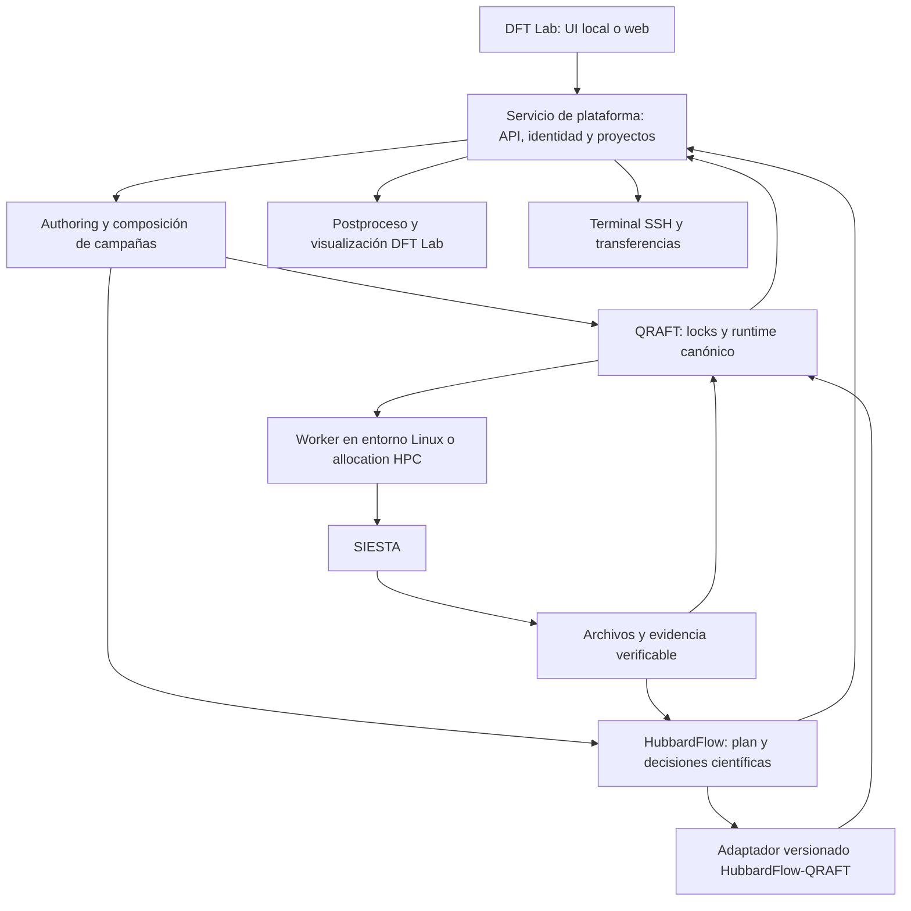

# Integración de DFT Lab, QRAFT HPC y HubbardFlow

Fecha: 10 de octubre de 2026. Revisión focalizada de arquitectura y contratos de integración.

**Dictamen:** los dos repositorios aportan infraestructura real y pertinente. Recomiendo reutilizarlos y construir DFT Lab como interfaz y servicio de integración. La tarea principal pasa a ser definir el intercambio de planes, evidencia y decisiones, y evitar autoridades de ejecución duplicadas.

## 1. Versiones examinadas y alcance

| Proyecto | Referencia examinada | Función |
|---|---|---|
| DFT Lab | Copia local previamente revisada | Enseñanza, estructuras, entradas y análisis visual |
| QRAFT HPC, repositorio `siestaflow` | `4d996ea7c580e5638e470bbf32624c88fd762f7d` | Composición, compilación, runtime, recursos, intentos y evidencia |
| HubbardFlow | Rama `codex/hubbardflow-rename`, resuelta a `e508f47aff1c6243deabb12915063b6b9d899d65` | Planificación, ejecución y análisis especializado de respuesta Hubbard |

Se clonaron ambos repositorios en una carpeta temporal separada. Se leyeron contratos, controladores, adaptadores, documentación y pruebas relevantes, y se ejecutaron suites focalizadas. Esta revisión no constituye una auditoría exhaustiva de los dos repositorios ni una nueva validación científica de materiales.

El análisis anterior evaluaba la especificación pegada y la aplicación local: no tenía estos motores como evidencia. La crítica a la invariancia estricta de ocupaciones corresponde a esa especificación. El `state_gate` actual de HubbardFlow tiene otro contrato y debe evaluarse según su código.

## 2. Qué existe realmente en QRAFT

El repositorio `siestaflow` ya distribuye el paquete `qraft-hpc`, import y CLI `qraft`, versión declarada 0.2.0. Su documentación declara Linux/POSIX como entorno soportado y mantiene algunos identificadores `siestaflow.*` por compatibilidad. [README del commit revisado](https://github.com/Jairomcarmona/siestaflow/blob/4d996ea7c580e5638e470bbf32624c88fd762f7d/README.md).

Hay implementación concreta de:

- `WorkflowDefinition`, compilación y `CompiledWorkflow`, con nodos, dependencias y puertos de archivos.
- `WorkflowFragment` y `WorkflowComposer`, que comprueban tipos científicos y media types al conectar fragmentos.
- `CapabilityRegistry`, descriptores de plugins y contratos versionados.
- `CompiledWorkflowRuntime`, ejecución de nodos listos y coordinación de recursos para paralelismo.
- Intentos, manifiestos con hashes, journal de estado y recuperación verificando evidencia.
- Adaptadores de lanzamiento direct, OpenMPI, `srun` y Hydra.
- Preparación de paquetes con `workflow.lock.json` y `run.lock.json`.

El compositor y el runtime son puntos de integración adecuados para DFT Lab. No hace falta construir otro scheduler DAG dentro del frontend. [Composición de fragmentos](https://github.com/Jairomcarmona/siestaflow/blob/4d996ea7c580e5638e470bbf32624c88fd762f7d/src/qraft/workflow_composition.py), [runtime](https://github.com/Jairomcarmona/siestaflow/blob/4d996ea7c580e5638e470bbf32624c88fd762f7d/src/qraft/execution/capability_runtime.py).

### Límites importantes del corte actual

El registro de plugins no significa que cualquier capacidad pueda atravesar toda la ruta de despliegue. `RunPreparer` permite inyectar adaptadores, pero su preparación ordinaria exige capacidades concretas, rechaza tipos no soportados y prepara un destino SLURM. El controlador canónico registra explícitamente sus capacidades antes de congelar el registro. Un plugin Hubbard debe cablearse en authoring, compilación, preparación, empaquetado y ejecución. [RunPreparer](https://github.com/Jairomcarmona/siestaflow/blob/4d996ea7c580e5638e470bbf32624c88fd762f7d/src/qraft/run_preparation.py#L732), [controlador canónico](https://github.com/Jairomcarmona/siestaflow/blob/4d996ea7c580e5638e470bbf32624c88fd762f7d/src/qraft/execution/canonical_controller.py#L161).

También hay documentación histórica que describe una separación entre compilador y controlador. El código actual muestra una evolución posterior: `CanonicalController` traduce la configuración de compatibilidad hacia `CompiledWorkflowRuntime`, y el protocolo de convergencia utiliza ese runtime. Conviene exponer versiones y estado de autoridad en la documentación; una nota antigua no debe presentarse como diagnóstico del HEAD actual.

La UI debe consumir la ruta canónica seleccionada, evitando escoger silenciosamente el controlador histórico por tener un nombre familiar. Los launchers MPI y la ejecución dentro de una allocation no sustituyen la integración SSH ni el envío y seguimiento externo de trabajos. Tampoco demuestran soporte actual de PBS o Kubernetes.

## 3. Qué existe realmente en HubbardFlow

La rama revisada contiene separación entre `domain`, `siesta_backend`, `execution` y `reporting`. Su paquete declarado es `hubbardflow` 0.1.2. Existen contratos de planes, políticas, evidencia, respuesta y certificación que superan ampliamente el DAG de ocho corridas de la especificación inicial. [README del snapshot revisado](https://github.com/Jairomcarmona/SIESTAFLOW_HUBBARD_RESPONSE_BACKBONE/blob/e508f47aff1c6243deabb12915063b6b9d899d65/README.md).

`ResolvedPerturbationPlan` contiene versiones, hashes de entradas, inventario de subespacios, referencia, cobertura, protocolo, calibración, columnas calculadas, run specs y mapas de reconstrucción. Tiene serialización y digest. Es una base útil para un contrato de intercambio. [Plan resuelto](https://github.com/Jairomcarmona/SIESTAFLOW_HUBBARD_RESPONSE_BACKBONE/blob/e508f47aff1c6243deabb12915063b6b9d899d65/src/hubbardflow/domain/perturbation_plan.py#L204).

Existen `LRDag`, constructores de grafos iniciales y adaptativos, y `GenericDagExecutor`, que acepta un `NodeExecutor` inyectado y recibos. Ese executor avanza de forma serial y conserva checkpoints; no debe confundirse con un scheduler paralelo completo. El DAG tiene dataclasses y un digest interno, pero falta consolidar una API pública de intercambio que represente todos sus puertos, semánticas y autorizaciones. [Executor genérico](https://github.com/Jairomcarmona/SIESTAFLOW_HUBBARD_RESPONSE_BACKBONE/blob/e508f47aff1c6243deabb12915063b6b9d899d65/src/hubbardflow/execution/generic_executor.py), [DAG LR](https://github.com/Jairomcarmona/SIESTAFLOW_HUBBARD_RESPONSE_BACKBONE/blob/e508f47aff1c6243deabb12915063b6b9d899d65/src/hubbardflow/execution/lr_dag.py).

### Gate y significado del resultado

El gate actual se describe como diagnóstico. Evalúa evidencia orbital, magnética y de bandas y produce resultados explícitos. La comprobación de suavidad G3 devuelve `NOT_ESTABLISHED` con motivo `SMOOTHNESS_REQUIRES_SCF_LADDER`; no debe mostrarse como continuidad global demostrada. [Evaluación del gate](https://github.com/Jairomcarmona/SIESTAFLOW_HUBBARD_RESPONSE_BACKBONE/blob/e508f47aff1c6243deabb12915063b6b9d899d65/src/hubbardflow/domain/state_gate_eval.py#L351).

El análisis entrega `U_scalar_charge`. Su contrato prohíbe promover automáticamente ese valor a `Ueff_Dudarev`; exige evidencia explícita de la semántica apropiada. DFT Lab debe preservar esta distinción en resultados, exportaciones y generación de entradas. Una unidad eV compartida no hace equivalentes las cantidades. [Semántica de parámetros](https://github.com/Jairomcarmona/SIESTAFLOW_HUBBARD_RESPONSE_BACKBONE/blob/e508f47aff1c6243deabb12915063b6b9d899d65/src/hubbardflow/domain/hubbard_parameter_semantics.py#L22).

El protocolo también establece restricciones sobre inversión directa, ausencia de pseudoinversa/fallback y selección de amplitudes/políticas. La integración conservará esas decisiones. Mis recomendaciones generales anteriores de diagnóstico de rango no autorizan a sustituir la política científica de este motor ni a introducir regularización. [Política numérica](https://github.com/Jairomcarmona/SIESTAFLOW_HUBBARD_RESPONSE_BACKBONE/blob/e508f47aff1c6243deabb12915063b6b9d899d65/src/hubbardflow/domain/u_matrix.py).

Las calificaciones de materiales y reportes V6 que trae el repositorio son evidencia histórica con un protocolo y versión específicos. No se convierten en aceptación automática para cualquier material, configuración o nueva campaña.

## 4. Arquitectura conjunta recomendada

| Capa | Autoridad |
|---|---|
| DFT Lab | Selección y visualización; no recalcula decisiones científicas para habilitar ejecución |
| Servicio de plataforma | Usuarios/proyectos, permisos, archivos, solicitudes e identidad de operaciones |
| QRAFT | Locks, ejecución, recursos, intentos, dependencias operativas y procedencia técnica |
| HubbardFlow | Plan LR, políticas, cobertura, interpretación de ocupaciones, análisis y decisiones científicas |
| Adaptador | Traducción verificable entre contratos; no incorpora umbrales o física propios |
| Perfil y runtime del sitio | Allocation, launcher, MPI y entorno aprobado para ese sitio |

Ambas lógicas pueden formar parte del backend de una plataforma web y construir campañas invocadas por la interfaz. El motor operativo debe poder alojarse también cerca del cálculo: dentro de una allocation HPC o en una VM. La interfaz web no exige ejecutar los launchers y el controlador HPC en el mismo proceso que atiende HTTP.

En el despliegue local inicial, DFT Lab y su servicio pueden ejecutarse en la laptop; QRAFT y HubbardFlow se invocan en un entorno compatible, local mediante WSL o remoto. La portabilidad Windows del frontend no implica soporte Windows completo de QRAFT. Las pruebas puras ejecutadas aquí tampoco establecen ese soporte.

La migración web cambia identidad, autorización y almacenamiento compartido, conservando contratos científicos y adaptadores. No implica convertir SLURM en Kubernetes.

## 5. Integración gradual sin dos controladores competidores

### Primera integración: una subcampaña encapsulada

Propongo añadir una capacidad QRAFT especializada que ejecute una campaña HubbardFlow completa dentro de una allocation declarada. Es un adaptador nuevo; no existe cableado en los repositorios examinados.

- QRAFT gestiona la tarea exterior, su presupuesto, entorno, intentos y dependencias de la campaña general.
- HubbardFlow conserva su planificación, estado interno y decisiones del protocolo LR.
- Se identifica cada nodo interno como hijo de la tarea exterior, con sus hashes y evidencia.
- La allocation y recursos reservados cubren los launchers internos; no se vuelve a enviar cada hijo a otra cola ni se multiplica el controlador bajo MPI.
- Cancelación, reanudación y progreso se traducen explícitamente entre los niveles.

Esta composición jerárquica es aceptable porque cada nivel tiene un ámbito distinto. Lo que debe evitarse es que ambos motores reintenten o lancen la misma tarea interna con autoridad independiente.

No basta envolver `hubbardflow run` en un comando y comprobar exit code 0. `GenericCommandCapability` de QRAFT interpreta éxito del proceso, no el significado científico del resultado. La capacidad especializada debe comprobar el contrato, archivos y veredictos HubbardFlow; un gate independiente controla si esos resultados habilitan un cálculo posterior. [Clasificación del comando genérico](https://github.com/Jairomcarmona/siestaflow/blob/4d996ea7c580e5638e470bbf32624c88fd762f7d/src/qraft/execution/command_capability.py#L76).

La integración encapsulada reduce el riesgo de alterar un protocolo ya desarrollado, aunque limita el aprovechamiento del paralelismo entre nodos internos. La UI puede mostrar el subgrafo sin asumir su ejecución.

### Integración posterior: fragmentos y nodos explícitos

Una vez cerrado el contrato, HubbardFlow podría aportar fragmentos y capacidades al compositor QRAFT. QRAFT ejecutaría los nodos; HubbardFlow interpretaría observaciones y decidiría los gates, sin que su executor independiente programe simultáneamente esos nodos.

Este modo exige un export público versionado, handlers registrados para cada tipo de nodo y una política definida para las etapas adaptativas. No consiste en convertir dataclasses a JSON y renombrar estados.

Los bucles adaptativos deben respetar la inmutabilidad de locks: cada decisión nueva produce una etapa o revisión enlazada, autorizada por la política y presupuesto registrados. Una aprobación que el protocolo requiere debe mantenerse como gate; el hecho de disponer de una UI web no la elimina.

## 6. Contrato del adaptador

El siguiente contrato es una propuesta nueva, no una API ya implementada:

| Operación | Entrada | Salida verificable |
|---|---|---|
| `describe_capabilities` | Versiones de ambos motores | Modos, schemas y compatibilidades soportadas |
| `plan` | Intención científica, entradas y políticas explícitas | Plan Hubbard resuelto y digest, grafo y requisitos |
| `export_fragment` | Plan autorizado | Fragmento QRAFT y mapa de identidades/archivos |
| `validate_observation` | Evidencia de un intento | Observación científica tipada y recibo de validación |
| `evaluate_gate` | Observaciones necesarias y política | Decisión, motivos, evidencia y próximos pasos permitidos |
| `analyze` | Conjunto validado de observaciones | Matrices, cantidades, intervalos, diagnósticos y alcance |
| `resume_check` | Estado y archivos anteriores | Reutilización admisible y trabajo pendiente |

El intercambio debe contener, al menos: schemas, commits/distribuciones de ambos motores, digest del plan, hashes de políticas y entradas efectivas, sitio y subespacio, modo bare/screened, amplitud con unidad, identidad de referencia/DM, identidad de intento, ocupaciones con fuente y precisión, artefactos, validaciones y estado científico.

El resultado debe separar tipo de cantidad, valor, unidades, incertidumbre/bounds, diagnóstico y aceptación. No se pierde `NOT_ESTABLISHED`, `REVIEW` o `NUMERICAL_CANDIDATE_UNASSESSED` durante la traducción.

Una tabla de correspondencia entre estados operativos es útil, pero el éxito técnico de QRAFT y el veredicto científico Hubbard siguen siendo campos distintos. No reemplazaría los enums originales ni reescribiría archivos históricos para uniformarlos.

Los artefactos bare y screened requieren validadores diferentes: una corrida bare intencionalmente no autoconsistente no debe rechazarse por el validador de una referencia SCF. Tampoco deben aceptarse todas las corridas incompletas como bare.

## 7. Riesgos de integración que requieren resolver

### A. Una sola autoridad por ejecución

El runtime QRAFT usa un `threading.RLock` para coordinar su estado interno. Eso protege threads de una instancia, no dos procesos de servidor que intentan controlar el mismo directorio. La plataforma necesita exclusión entre controladores, identidad de solicitud y reconciliación tras pérdida de confirmación.

El API puede almacenar proyectos, permisos, operaciones e índices en una base de datos. Los journals y manifiestos QRAFT siguen siendo la evidencia canónica de la ejecución; no se crea un segundo motor de estados que decida qué nodo lanzar.

### B. Reanudación sin contaminar identidades

QRAFT ya verifica manifiestos, fuentes y archivos al reutilizar intentos; no debe sustituirse por el `manifest.json` simplificado de la propuesta. Su fingerprint incluye identidad científica, ejecución y capacidades, por lo que cambiar recursos o perfiles puede requerir un procedimiento explícito de nueva ejecución/revisión. El servicio no debe eludir esa comprobación para implementar un botón «resume».

En la integración inicial hay estado exterior QRAFT e interior HubbardFlow. La reanudación debe comprobar ambos y enlazar los intentos; no deducir que todos los nodos internos siguen siendo válidos porque la tarea exterior tiene archivos guardados.

### C. La autoridad científica permanece en HubbardFlow

La UI no elegirá amplitudes, ventanas o criterios para obtener un U atractivo, ni introducirá una pseudoinversa al detectar singularidad. Conserva las políticas explícitas y permite presentar evidencia y decisiones del motor. Cambiar una política exige un nuevo digest/revisión.

La calificación de continuidad y el informe de calidad deben mostrar sus límites. Un gate diagnóstico favorable no elimina el estado de suavidad no establecido ni reemplaza las pruebas de convergencia que el protocolo requiera.

### D. Entornos y empaquetado

QRAFT declara Python >=3.11; las instrucciones y configuración de HubbardFlow trabajan con Python 3.12 y NumPy <2. Una combinación inicial razonable es un worker Linux con Python 3.12 y dependencias fijadas, probado con ambos paquetes. La compatibilidad del código fuente no sustituye validar las distribuciones instaladas.

Separar procesos puede facilitar la primera integración y aislar dependencias. Las versiones deben figurar en los resultados. No instalar el proyecto ajeno `qraft` de PyPI en el mismo entorno: el README de QRAFT advierte que comparte import y comando.

### E. Interfaz pública y exposición web

Falta definir el servicio HTTP/eventos y autorización de operaciones. Los plugins son código confiable instalado por el operador; no permitir que un usuario web cargue Python arbitrario o elija libremente argv del worker.

Rutas, archivos, perfiles y terminales tienen permisos por proyecto/usuario. Grandes resultados se transfieren por flujo y se almacenan fuera de la memoria de la página. Los defectos de tratamiento de HTML en DFT Lab deben cerrarse antes de conectar autoridad remota.

## 8. Verificación realizada

Entorno: Windows, Python 3.12, NumPy 1.26.4 y pytest 9.1.1. PyYAML 6.0.3 se añadió a una carpeta de dependencias temporal, sin instalar QRAFT globalmente.

| Grupo | Resultado |
|---|---|
| QRAFT: plugins, serialización/versionado, compilación, composición, runtime y journal | 46 passed, 1 skipped |
| QRAFT: preparación de paquetes y modelo de fallos/composición | 9 passed |
| HubbardFlow: arquitectura de imports, LR, matrices, respuesta cuantizada y certificación | 80 passed |
| HubbardFlow: state gate, plan resuelto, semántica U, executor y plan de campaña | 92 passed, 2 xfailed |

Total: **227 pruebas pasaron, 1 se omitió y 2 quedaron como fallos esperados**. La omitida requiere `SIGUSR1`, ausente en Windows. Los dos xfails están registrados por el repositorio y corresponden al namespace histórico `src/siestaflow_hubbard`; no se modificaron para hacerlos pasar. Las pruebas Hubbard también emiten avisos de deprecación de rutas adaptativas históricas.

Estos resultados respaldan contratos y comportamientos concretos. No certifican el despliegue Linux/HPC, el plugin conjunto, todos los modos científicos ni el funcionamiento de una plataforma web. No se ejecutaron cálculos SIESTA ni se enviaron trabajos remotos.

### Pruebas necesarias del futuro adaptador

1. Plan Hubbard → fragmento QRAFT, conservando hashes, modos, sitios y políticas.
2. Bare y screened interpretados por sus validadores correspondientes.
3. Resultado técnico exitoso con veredicto científico no establecido, sin promoción automática.
4. Rechazo de un cambio de identidad de DM, pseudo, políticas o archivos.
5. Interrupción y reanudación con estado exterior/interior coherente.
6. Cancelación de la tarea exterior sin procesos científicos huérfanos.
7. Dos solicitudes web simultáneas sin dos controladores para la misma ejecución.
8. Un caso pequeño real con el entorno Linux y ejecutable objetivo.

## 9. Recomendación revisada

La plataforma debe crecer sobre QRAFT y HubbardFlow mediante un adaptador versionado. No recomiendo añadir ahora AiiDA como un tercer controlador ni sustituir los journals de QRAFT por otro motor diseñado desde cero.

El primer hito sería una campaña Hubbard encapsulada dentro de una campaña QRAFT, operada desde el servicio local y visible en DFT Lab, con estados y evidencia correctamente separados. El siguiente sería exponer fragmentos científicos para aprovechar el runtime QRAFT a nivel de nodo, una vez cerrado el contrato.

Tu idea de que ambos motores construyan campañas desde una interfaz local o web es viable. Para concretarla, la prioridad es cerrar sus fronteras, demostrar una ruta completa y conservar la autoridad científica y las identidades de cada motor.
