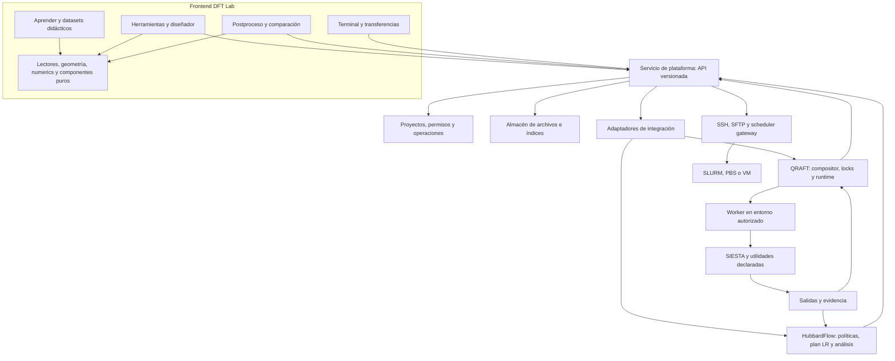
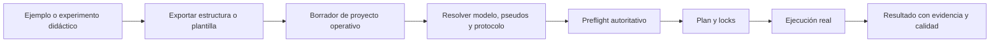
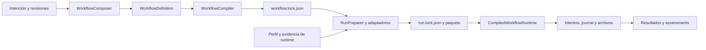
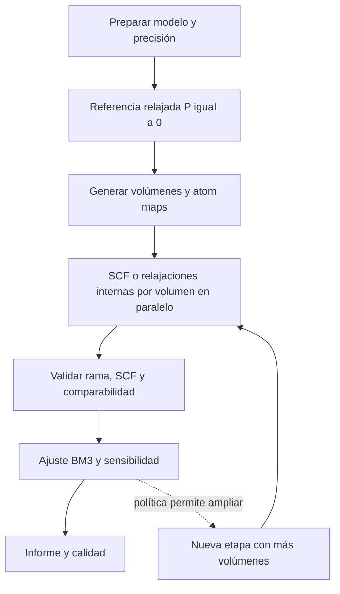
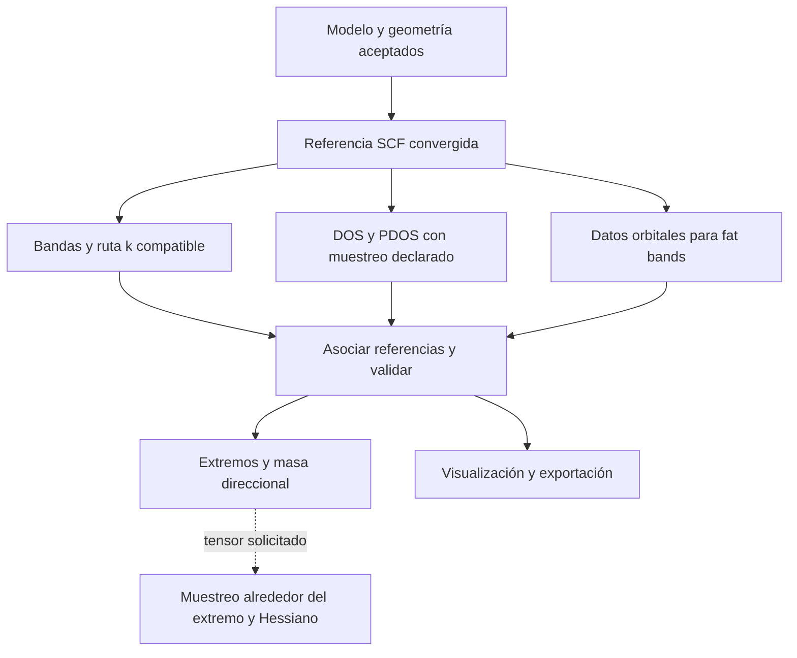
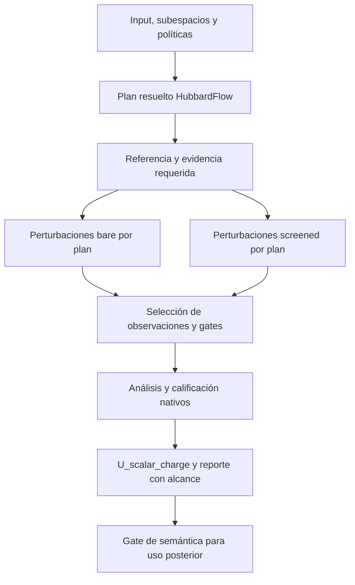
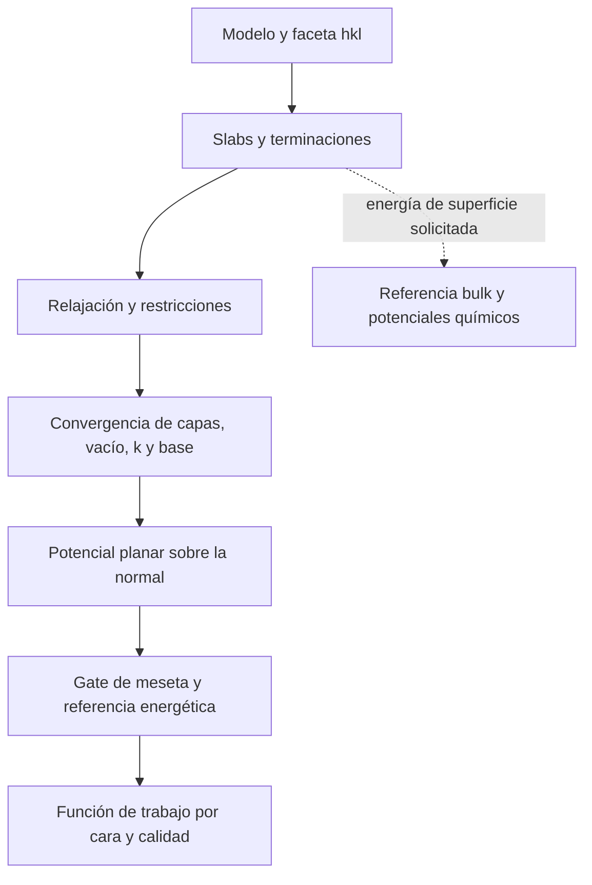
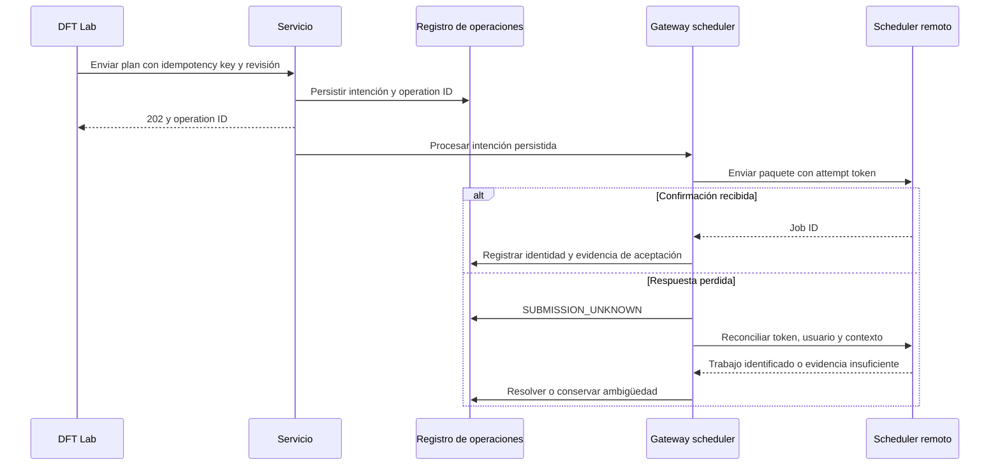
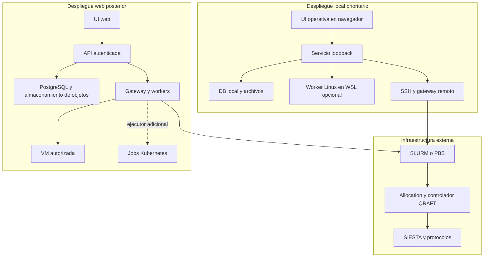
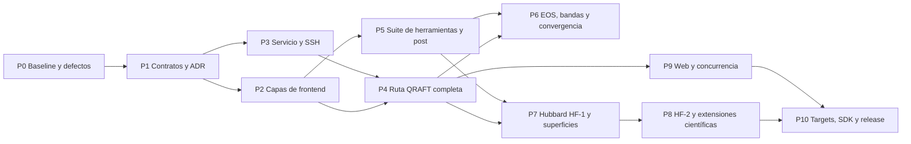

# DFT Lab V2: arquitectura, contratos e integración científica

Fecha: 10 de octubre de 2026. Estado: propuesta de arquitectura para implementar con Claude Code. Versión del documento: 2.1, endurecida tras revisión adversarial.

Este documento actualiza la propuesta original de DFT Lab + QRAFT-HPC + HubbardFlow. Define el destino completo y una ejecución incremental; no afirma que las funciones propuestas ya existan. El backlog complementario está en [PLAN_IMPLEMENTACION_CLAUDE_CODE.md](PLAN_IMPLEMENTACION_CLAUDE_CODE.md).

La [revisión adversarial](AUDITORIA_ADVERSARIAL_ARQUITECTURA_PRODUCCION.md) identifica 15 brechas y justifica las correcciones de §25. Esa sección precisa los mecanismos de producción y adelanta controles que V2 dejaba para P10. Todos los requisitos funcionales R-01…R-42 se conservan; se añaden R-43…R-50 de endurecimiento.

Lectura recomendada: §§2–8 para capas, autoridades y contratos; §§9–12 para toda la suite y los workflows; §§13–19 para operación, despliegue y calidad; §§20–25 para fases, cobertura y cambios frente a las propuestas anteriores. Claude Code debe usar este documento junto con el backlog, comenzando por baseline y contratos.

**Decisión central:** conservar DFT Lab como frontend modular con distribución portátil, integrar QRAFT como runtime y compositor operativo, y preservar HubbardFlow como autoridad del protocolo de respuesta Hubbard. Un servicio de plataforma coordina API, identidad, proyectos, SSH y archivos. El aprendizaje y la producción científica comparten utilidades puras, pero tienen estados, procedencia y autoridad separados.

## 0. Base verificada y alcance de esta actualización

| Base | Referencia | Qué aporta |
|---|---|---|
| DFT Lab | Copia local revisada | 19 vistas: inicio, 15 capítulos, dos herramientas y postproceso; HTML portátil; lectores y numerics |
| QRAFT HPC | `Jairomcarmona/siestaflow@4d996ea7c580e5638e470bbf32624c88fd762f7d` | Contratos, fragmentos, compilación, locks, runtime, recursos, intentos y evidencia |
| HubbardFlow | `Jairomcarmona/SIESTAFLOW_HUBBARD_RESPONSE_BACKBONE@e508f47aff1c6243deabb12915063b6b9d899d65` | Planes LR, políticas, evidencia, análisis y ejecución especializada |
| Motor de referencia | SIESTA 5.4.2 | Ejecutable externo; capacidades dependen de compilación y perfil del sitio |

La biblioteca actual reúne 30 elementos con variantes LDA/PBE: 60 archivos, no 60 elementos. El soporte educativo de una función no implica soporte operativo certificado. En particular, los capítulos conceptuales de SOC, híbridos o GW no autorizan su ejecución.

Se preservan las baselines científicas congeladas de HubbardFlow y sus instrucciones de repositorio. El adaptador no modifica definiciones, políticas de inversión, amplitudes ni criterios de certificación. Los cambios necesarios en los motores se hacen en sus repositorios con pruebas y publicaciones propias.

Esta propuesta constituye una actualización explícita recomendada de `ARQUITECTURA.md`; su adopción requiere registrar los nuevos ADR y migrar ese contrato. No autoriza a ignorar arbitrariamente instrucciones existentes. Las revisiones previas y sus evidencias están en [ANALISIS_TECNICO.md](ANALISIS_TECNICO.md) e [INTEGRACION_DFTLAB_QRAFT_HUBBARDFLOW.md](INTEGRACION_DFTLAB_QRAFT_HUBBARDFLOW.md).

## 1. Objetivo de producto y alcance funcional completo

El recorrido es: aprender → importar/preparar → validar → planificar → ejecutar externamente → evaluar evidencia → analizar/comparar → reproducir/publicar. El usuario puede ejecutar una operación aislada, seleccionar fragmentos o usar una campaña completa.

La versión local es prioritaria: interfaz y servicio en la laptop, terminal SSH y cálculo en nube/HPC. La arquitectura prepara una plataforma web con identidades y proyectos, sin cambiar la física ni crear una edición divergente de los motores.

### 1.1 Navegación y áreas

| Área | Contenido y autoridad |
|---|---|
| Inicio | Capacidades instaladas, ejemplos, proyectos recientes; no presupone conexión |
| Aprender | Los 15 capítulos actuales, datos didácticos y experimentos numéricos locales |
| Herramientas | Los cuatro estudios descritos abajo, calculadoras y preparación offline |
| Campañas | Planes, DAG, ejecuciones, presupuestos, gates, intentos y recuperación |
| Postproceso | Archivos importados, resultados de campañas, comparación y exportación |
| Remoto | Terminales, conexiones, transferencias y contexto del sitio |
| Proyectos | Estructuras, revisiones, archivos, perfiles referenciados e informes |

La nueva área Campañas no elimina el diseñador de campañas de Herramientas: el diseñador crea una intención/plan; Campañas gestiona su ciclo operativo. Proyectos puede comenzar como selector compartido, sin una pantalla compleja inicial.

### 1.2 Los cuatro estudios obligatorios

| Estudio | Funciones que deben quedar cubiertas |
|---|---|
| Cristalografía y geometría | Importación/exportación; Moyo; grupo espacial, Hall y Wyckoff; celda estándar/primitiva/convencional; superceldas; slabs hkl; vacío y capas; Seekpath; BZ y visor 3D |
| Corridas simples | Molécula; bulk y relajación; slab restringido; SCF estático; densidad/potencial y Denchar; vibraciones moleculares FC; spin/carga según capacidades; bundle FDF+pseudos+launcher |
| Preflight FDF | FDF externo y sus includes; sintaxis y valores efectivos; coherencia; pseudopotenciales; modo guiado/experto; diff de correcciones; audit log; bundle completo o marcado incompleto |
| Campañas | EOS; bandas/fat bands/PDOS y masas; HubbardFlow LR-U; superficies/función de trabajo; composición y convergencia; exportación, ejecución y recuperación |

Además se mantienen todas las calculadoras existentes y los lectores/postprocesos actuales. Fonones periódicos, óptica y exploración magnética se incorporan como extensiones operativas con sus protocolos, aprovechando las funciones educativas y capacidades disponibles; no se anuncia soporte solo porque exista una gráfica o un parser.

## 2. Decisiones fundacionales y reglas que no deben romperse

1. El navegador no ejecuta SIESTA. Los numerics propios del frontend siguen permitidos, con alcance declarado.
2. La entrega HTML portátil funciona sin servicio para aprender, preparar, leer y exportar. La ejecución requiere un servicio autenticado.
3. Se mantiene una sola fuente de frontend, una sola autoridad de ejecución por tarea y una sola definición de cada decisión científica.
4. Un resultado técnicamente terminado no equivale a convergido, certificado o adecuado para una publicación.
5. Ningún valor numérico nuevo se presenta como umbral científico universal: pertenece a una política/protocolo versionado y justificado.
6. Los locks y archivos de evidencia son inmutables. Cambiar una intención crea una revisión; cambiar un intento no borra el anterior.
7. El servicio no almacena otro DAG que compita con QRAFT. Sus índices y tablas son proyecciones o gestión de operaciones/proyectos.
8. Plugins y perfiles de ejecución son código/configuración confiable administrados; una campaña importada es datos no confiables.
9. Compatibilidad, portabilidad y certificación se declaran mediante evidencia, por función, motor, versión y sitio.
10. Cada requisito tiene propietario, fase, prueba y estado. Una función pendiente se muestra como pendiente o no soportada.

Estas reglas reducen riesgos futuros; no sustituyen pruebas, observación de despliegues y mantenimiento de dependencias.

## 3. Arquitectura de componentes y dependencias



### 3.1 Capas

| Capa | Responsabilidad | Dependencias permitidas |
|---|---|---|
| Presentación | Vistas, componentes, gráficas, accesibilidad y estado transitorio | SDK, view models, utilidades puras |
| Aplicación frontend | Casos de uso UI, selección, sesiones, caché y cancelación | Contratos y SDK; sin SDK de scheduler |
| Dominio de plataforma | Proyecto, revisión, permiso, identidad de operación y archivo | Tipos propios; sin FastAPI, SSH o UI |
| Aplicación backend | Crear plan, preparar, enviar, reconciliar, cancelar y recolectar | Puertos abstractos, contratos y políticas de plataforma |
| Integración científica | Adaptar QRAFT/HubbardFlow y empaquetar capacidades | APIs públicas de los motores |
| Infraestructura | HTTP, DB, SSH, scheduler, almacenamiento y observabilidad | Implementa puertos de aplicación |
| Dominio científico | Métodos, políticas, validadores y decisiones | Permanece en el motor/protocolo propietario |

Las dependencias apuntan hacia contratos y dominio; el dominio no importa infraestructura. No se impone una reescritura completa del frontend: se crean límites y adaptadores alrededor del código aprovechable.

### 3.2 Estructura propuesta del repositorio de plataforma

```text
DFT_App_completo/
  app/                             frontend existente, conservado
    dftlab/static/js/
      core/                        DOM seguro, charts, ViewScope y componentes
      siesta/ crystal/ physics/    módulos puros existentes
      application/                casos de uso y view models
      sdk/                        API HTTP/eventos y cliente remoto
      learn/                      datasets/manifiestos didácticos y helpers
      tools/                      editores y preparación
      views/                      pantallas y registro compatible
      workers/                    tareas numéricas/lectores cancelables
    scripts/                     build portátil y build operativo
  platform/
    src/dftlab_platform/
      domain/ application/ api/
      integrations/qraft/ integrations/hubbardflow/
      infrastructure/ssh/ schedulers/ storage/ identity/
    tests/                       unidades, contratos, integración y fallos
  contracts/
    schemas/ examples/ fixtures/  schemas de plataforma, sin copiar enums nativos
    openapi/ events/             interfaces publicadas
  docs/
    adr/ protocols/ runbooks/ compatibility/ acceptance/
  deployment/
    local/ worker/ web/          empaquetado y perfiles ejemplo no operativos
  engine-versions.lock.json       versiones, commits y hashes de distribuciones
```

QRAFT y HubbardFlow siguen como paquetes/repositorios independientes. No copiar sus fuentes al árbol de plataforma ni crear un fork temporal sin mecanismo de actualización. Los cambios públicos requeridos se publican upstream y se fijan por versión/commit. La integración no usa nombres privados de los motores.

## 4. Separación rigurosa de aprendizaje y producción

### 4.1 Contratos de origen, finalidad y confianza

Cada dataset/resultado tiene campos distintos:

- `origin`: ejemplo incorporado, simulación didáctica, importación del usuario o ejecución rastreada.
- `purpose`: educativo, exploratorio u operativo.
- `provenance_state`: verificado, parcial o desconocido.
- `scientific_assessment`: decisión del protocolo correspondiente, independiente de los anteriores.

Un ejemplo incorporado puede provenir de una corrida real y tener procedencia excelente. Su finalidad educativa no significa que sea falso; tampoco autoriza reutilizar sus parámetros sin revisión para otro sistema.



Se permite llevar un resultado real a Aprender para explicarlo, mediante una vista de lectura. La vista educativa no modifica los archivos originales ni su calificación científica. Los datos didácticos nunca se mezclan automáticamente con el almacén de campañas.

### 4.2 Aislamiento de estado y ciclo de vida

Cada pantalla obtiene un `ViewScope`: AbortController, subscriptions, listeners, workers, timers y disposables. Al navegar se cancela trabajo pendiente, se destruyen visores/controles y se desuscriben observadores de tema. Una respuesta async de una vista anterior no puede modificar la nueva.

El router mantiene un adaptador para `mount(root)` y `destroy()` existentes; después puede introducir `mount(root, context)` devolviendo un disposer. La migración es incremental y comprobada. `onTheme` debe permitir desuscripción; los callers antiguos se mantienen hasta migrarlos.

Los capítulos conservan dropzones independientes. Postproceso usa un contexto de dataset/proyecto separado. No se comparte un singleton mutable de estructura o archivos entre vistas; los casos de uso reciben IDs o snapshots explícitos.

Los cálculos de átomo radial, diagonalización de FC, mallas o ingestión pesada migran a workers cuando bloquean la UI. Cada worker tiene límites, progreso y cancelación; sus resultados se etiquetan con la versión del algoritmo. Las vistas científicas presentan datos del motor y no reproducen sus gates con fórmulas distintas.

### 4.3 Distribuciones del mismo frontend

| Distribución | Uso | Recursos |
|---|---|---|
| `dftlab.html` | Aprender/preparar/postprocesar offline | Datos y recursos necesarios embebidos, con límites de archivos grandes |
| Build operativo local | Servicio en loopback | Activos separados, CSP, SDK y carga por demanda |
| Build web | Servicio remoto autenticado | Mismo frontend y API; identidad y permisos web |

La salida portátil y el empaquetado de aproximadamente 12 MB se conservan. El build operativo permite chunks y datasets por demanda; no se duplican pantallas. Las fuentes necesarias para fidelidad offline se empaquetan con su licencia. El grupo Remoto se habilita por handshake; la comprobación de disponibilidad no concede autorización.

## 5. Fuentes de autoridad y contratos de datos

### 5.1 Propietario de cada contrato

| Contrato | Propietario |
|---|---|
| UI, proyecto, operación, origen y permisos | Plataforma DFT Lab |
| WorkflowDefinition/CompiledWorkflow, locks, attempts y runtime | QRAFT |
| Plan LR, políticas, observaciones y certificación Hubbard | HubbardFlow |
| Formatos SIESTA y capacidades del ejecutable | Adaptador SIESTA, con versión explícita |
| Dataset visual y lectura offline | Lectores DFT Lab; no autoridad de certificación operativa |

La plataforma puede envolver contratos nativos mediante referencias y metadatos, pero no redefinir sus enums, digests o decisiones. Una transformación conserva el contrato original, identifica la versión del adaptador y produce un archivo nuevo.

### 5.2 Envelope de plataforma propuesto

Campos mínimos: `schema_id`, `schema_version`, `record_id`, `project_id`, `producer`, `created_at`, `payload`, `native_contract_refs` y `integrity`. El producer registra paquete, versión, commit y algoritmo relevante. El ejemplo siguiente es ilustrativo y requiere convertirse en un schema ejecutable:

```json
{
  "schema_id": "dftlab.scientific-result",
  "schema_version": "1.0.0",
  "record_id": "result-example",
  "project_id": "project-example",
  "created_at": "2026-10-10T00:00:00Z",
  "producer": {"adapter": "dftlab.hubbard-adapter", "version": "1.0.0"},
  "payload": {
    "quantity_kind": "U_scalar_charge",
    "unit": "eV",
    "values_artifact_id": "artifact-example",
    "native_scientific_status": "NUMERICAL_CANDIDATE_UNASSESSED"
  },
  "native_contract_refs": [],
  "integrity": {"status": "UNVERIFIED"}
}
```

`UNVERIFIED` impide presentarlo como evidencia íntegra; el ejemplo no incluye un hash ficticio de producción. Los schemas completos exigen referencias y digest donde corresponda. IDs externos son opacos; las rutas del host no son identidad de archivo.

### 5.3 Modelo científico y archivos

| Entidad | Campos y reglas mínimas |
|---|---|
| StructureRevision | Celda, posiciones, representación, unidades, periodicidad, IDs estables de átomo, transformaciones y parent revision |
| SpeciesDefinition | Z, etiqueta/alias, pseudo, base, ghost/synthetic si soportado y asociación a átomos |
| PhysicalModel | XC, carga, spin, relatividad, Hubbard/subespacios y supuestos |
| NumericalPolicy | Base, malla real/k, smearing, solver, tolerancias y objetivo de convergencia |
| RunIntent | Qué observable/operación se pide, revisión de estructura/modelo y protocolo |
| SiteProfileRef | Perfil lógico y owner; configuración privada resuelta por el backend |
| ExecutionRequest | Recursos, runtime y revisión del plan; delega al contrato nativo QRAFT |
| ArtifactRecord | Tipo/media type, productor, tamaño, SHA-256, localizador privado, integridad y retención |
| ResultDataset | Ejes, unidades, componentes de spin, referencia energética, parser y procedencia |
| AssessmentRecord | Regla/protocolo, decisión original, motivos, evidencia, bounds/estimaciones y límites |
| LearningDataset | Origen, licencia, referencias, descripción, finalidad y manifest de archivos |

Se declara la convención existente de vectores de celda como filas y coordenadas fraccionarias; cualquier conversión explícita tiene una prueba de round-trip. Se registran unidades originales y normalizadas, y si k incluye 2π. Se conservan atom maps tras estandarización/supercelda/slab. Para condiciones periódicas se distingue intención física de la caja periódica usada por SIESTA.

NaN/Infinity no se serializan como números JSON. Un dato ausente se representa con null y un motivo/status; no con cero. Los enteros fuera del rango seguro JS, decimales exactos y tokens impresos para certificación viajan como strings tipados. La UI no redondea antes de devolver evidencia al motor.

### 5.4 Versiones, hashing y compatibilidad

Los schemas de plataforma usarán JSON Schema 2020-12 y la API un dialecto OpenAPI 3.1 que soporte el toolchain fijado; son decisiones de compatibilidad, no afirmaciones de que esas sean las únicas versiones disponibles. [JSON Schema](https://json-schema.org/draft/2020-12), [OpenAPI](https://spec.openapis.org/oas/v3.1.1.html).

SemVer se aplica a APIs/paquetes públicos: rupturas cambian major; capacidades compatibles cambian minor; correcciones compatibles cambian patch. Añadir un valor enum puede romper consumers exhaustivos: se evalúa como cambio de contrato, no se supone inocuo. [Semantic Versioning](https://semver.org/spec/v2.0.0.html).

Cada contrato anuncia versiones soportadas, migradores y periodo de compatibilidad. Un migrador crea una nueva representación enlazada, sin reescribir locks ni evidencia original. Los unknown fields de extensiones namespaced pueden preservarse; campos centrales o versiones incompatibles se rechazan con diagnóstico.

Se conservan digests nativos QRAFT/HubbardFlow con su algoritmo original. Para nuevos envelopes compartidos JS/Python se fija una canonicalización y fixtures comunes; JCS es una opción, teniendo en cuenta sus límites numéricos. Nunca sustituir `json.dumps` nativo por JCS en un lock existente. [RFC 8785](https://www.rfc-editor.org/rfc/rfc8785).

Se distinguen hashes de bytes, identidad científica, plan/protocolo, entorno de ejecución y parser/análisis. La plataforma respeta que el fingerprint actual QRAFT puede incluir recursos; una migración de recursos necesita una ruta explícita compatible. El SHA-256 prueba integridad comparada, no autenticidad ni permiso: permisos y firmas de publicación son controles diferentes.

### 5.5 Contratos de operación, referencias y análisis

Los siguientes nombres son públicos de plataforma. Cuando una entidad ya existe en un motor, el campo es una referencia versionada a su contrato y no una segunda definición.

| Contrato | Campos obligatorios / invariantes |
|---|---|
| NativeContractRef | Motor, distribución/versión/commit, schema nativo, digest y ArtifactRecord del documento original; el adaptador comprueba el documento |
| ArtifactRef | ID y digest/tipo esperado; no contiene credencial, path de ejecución libre ni URL que autorice acceso por sí misma |
| OperationRequest | Acción, project ID, target/revisión, payload tipado, idempotency key y budget/profile refs; el servidor deriva owner de la identidad autenticada |
| OperationRecord | ID, request hash, owner, timestamps, estado operativo, target refs, resultado/error y cursor; transición persistida antes de notificar |
| RunProjection | Refs nativas de workflow/run/attempt y dimensiones scheduler/ejecución/integridad/ciencia; last observed time y fuente por dimensión; no controla el DAG |
| ResumePlan | Run/attempt refs, verificaciones nativas, reuse/invalid/pending/seed refs, motivos, revisión/versiones, recursos/budget y caducidad/precondiciones |
| ValidationReceipt | Validador/versión, input refs/hashes, reglas/políticas, diagnósticos, alcance y decisión; un recibo viejo no valida un archivo modificado |
| AnalysisResult | Tipo de observable/modelo, input refs, algoritmo/versión/política, ResultDataset refs, AssessmentRecord refs y límites; nunca reemplaza originales |
| EventRecord | Envelope §6.2, identidad de recurso/operación y evidencia; filtros/autorización se comprueban también durante replay |
| CapabilityDescriptor | ID/version, schemas, semántica/protocolo, archivos, recursos, modos/targets, versiones admitidas, cancel/resume y referencias de pruebas |

`AssessmentRecord` no usa un booleano `valid` para resumir todo: conserva estado nativo, assessment type, regla, evidencia y scope. Un `ResultDataset` refiere a ejes/labels/matrices en artefactos y declara dtype/shape, unidades, orden de dimensiones, masks y valor ausente. Estos metadatos impiden confundir canales de spin, índices de átomo y unidades al cambiar de parser o interfaz.

Requests, registros persistidos y mensajes del worker tienen schemas diferentes. Campos de estado, owner, digest verificado y autoridad no se aceptan del navegador como hechos. Arrays grandes usan artefactos con contrato binario/metadata fijado; JSON no se fuerza como transporte universal de mallas/DM. Cada endpoint define tamaño/límites y si una referencia es local, importada o verificada.

## 6. API, eventos y contratos de integración operativa

### 6.1 API propuesta

FastAPI/Pydantic en un único servicio ASGI inicial; WebSocket para PTY y SSE para progreso si satisface los clientes. No combinar varios servidores HTTP/WebSocket equivalentes. SDK JS y CLI consumen la misma API versionada.

| Operación | Endpoint propuesto | Resultado |
|---|---|---|
| Disponibilidad | GET `/api/v1/health` | Salud mínima; sin configuración privada |
| Capacidades | GET `/api/v1/capabilities` | Versiones, features y estado de admisión |
| Proyectos/revisiones | `/api/v1/projects/...` | Recursos con permisos y revisión |
| Validar input | POST `/api/v1/projects/{id}/validations` | Diagnóstico autoritativo o ID de operación |
| Diseñar campaña | POST `/api/v1/projects/{id}/campaigns` | Borrador versionado |
| Planificar/compilar | POST `/api/v1/campaigns/{id}/plans` | Plan, gates y locks/referencias |
| Preparar paquete | POST `/api/v1/plans/{id}/packages` | Operación asíncrona y artefactos |
| Enviar ejecución | POST `/api/v1/plans/{id}/runs` | Operación con intención persistida |
| Consultar/cancelar | GET `/api/v1/runs/{id}`; POST `/api/v1/runs/{id}/cancel` | Estado observado; cancelación es solicitud |
| Preparar recuperación | POST `/api/v1/runs/{id}/resume-plans` | Plan de reutilización/reintento y justificación |
| Ejecutar recuperación | POST `/api/v1/resume-plans/{id}/runs` | Nuevo intento enlazado, sin editar el anterior |
| Archivos | `/api/v1/artifacts/...` | Metadata, staging, streaming y descarga autorizada |
| Eventos | GET `/api/v1/runs/{id}/events` | Stream con cursor y replay limitado |
| Terminal | POST `/api/v1/terminal-sessions`; WS por session ID | Sesión autenticada y autorizada |

Las operaciones largas devuelven 202 y una ubicación/ID consultable. El handler HTTP no mantiene vivo un cálculo ni usa una tarea en memoria como registro durable. Las solicitudes de mutación llevan una clave de idempotencia, ámbito de owner/proyecto, hash de request y precondición de revisión. Repetir la misma clave/payload devuelve la operación; cambiar payload con la misma clave produce conflicto.

GET `/api/v1/operations/{id}` devuelve el OperationRecord y sus refs; la vida de una operación API puede terminar al confirmar un submit aunque el run continúe. Crear un borrador/plan es distinto de autorizar recursos: el endpoint de run hace admisión por perfil, permisos, versión, integridad y presupuesto. Los defaults resueltos quedan en el plan; no se resuelven de nuevo según la configuración actual al enviar un plan antiguo.

Los errores usan Problem Details con código estable, request ID y detalles de campos, excluyendo secretos/rutas sensibles. Los rechazos científicos son assessments, no siempre errores HTTP. [RFC 9457](https://www.rfc-editor.org/rfc/rfc9457).

### 6.2 Eventos y recuperación de la UI

Envelope: `event_id`, `stream_id`, `sequence`, `occurred_at`, `recorded_at`, `type`, `schema_version`, `operation_id`, `run_id`, `attempt_id`, `payload` y reference a evidencia. Orden garantizado por stream, no globalmente. Los consumers deduplican por ID; no asumen entrega exactamente una vez.

La UI reconecta con cursor. Si el historial ya no está disponible, recibe una señal de resync y consulta un snapshot consistente. Los eventos de plataforma referencian los eventos nativos; no reemplazan los journals QRAFT. El output voluminoso va a archivos; el stream lleva segmentos acotados y progreso.

### 6.3 Puertos de backend propuestos

| Puerto | Operaciones |
|---|---|
| CampaignAuthoring | describe, compose, validate y compile mediante QRAFT |
| ScientificProtocol | plan, validate observations, evaluate gates, analyze y describe scope |
| RunPackageService | prepare, verify y inspect |
| Transport | connect, stage, retrieve, close y terminal; SSH/SFTP es una implementación |
| SchedulerGateway | capabilities, inspect allocation, submit, observe, cancel y reconcile |
| ArtifactStore | stage, commit, metadata, stream, verify y retention |
| Identity/Authorization | authenticate, authorize por recurso/acción y resolve secret reference |

Son interfaces de plataforma nuevas. Se diseñan desde los casos de uso y no se presentan como APIs actuales de los motores. Las adaptaciones nativas se prueban explícitamente.

La frontera de scheduling se declara por target. En la ruta inicial SLURM, SchedulerGateway envía/observa/cancela la allocation/job del controlador, y QRAFT decide nodos y recursos dentro de ella. Una ruta posterior de jobs por nodo necesita un executor declarado y un mapping propio de identidad; no se mezcla automáticamente con la primera. HubbardFlow HF-1 solo programa sus hijos dentro del ámbito reservado y HF-2 delega esos nodos a QRAFT. El servicio no interpreta readiness científica ni lanza por su cuenta los nodos del DAG.

### 6.4 Contrato remoto compatible

Se conserva `remote.available` y `connect(hostOrProfile) → Promise<Session>`; las sesiones son independientes. El servicio resuelve configuración, agente y credenciales. La UI nunca manda claves privadas ni expone una `session` singleton global.

`Session.terminal`, `put`, `get`, `run` y `close` permanecen mediante una fachada de compatibilidad. `get` usa ArrayBuffer solo para archivos pequeños con límite explícito; se añade una API de transferencia/stream para grandes. `run` es una capacidad manual privilegiada de terminal, no el mecanismo de los DAG. Los workflows utilizan SchedulerGateway y paquetes declarados.

La terminal ofrece xterm.js y fit, resize, Ctrl-C según semántica PTY, reconexión y cierre limpio. En PTY no se promete separación stderr/stdout que el terminal remoto no proporcione. Desconectar la terminal no cancela un trabajo batch. Su actividad no se graba indiscriminadamente porque puede incluir secretos; sí se auditan apertura, owner, host lógico y acciones de plataforma.

## 7. Integración QRAFT: una ruta operativa canónica

El frontend expresa intención; el compositor construye fragmentos compatibles; el compilador crea el DAG bloqueado; la preparación lo vincula a entorno/recursos; el runtime ejecuta y genera evidencia.



La figura es el recorrido objetivo de integración, no una afirmación de que todas las capacidades ya atraviesen la ruta de empaquetado. En el commit revisado `RunPreparer` tiene restricciones de tipos/capacidades y destino SLURM; los registros de runtime son explícitos. La entrega de un plugin exige cubrir todos esos puntos. [Código de preparación](https://github.com/Jairomcarmona/siestaflow/blob/4d996ea7c580e5638e470bbf32624c88fd762f7d/src/qraft/run_preparation.py), [runtime canónico](https://github.com/Jairomcarmona/siestaflow/blob/4d996ea7c580e5638e470bbf32624c88fd762f7d/src/qraft/execution/capability_runtime.py).

Cada capacidad operativa declara: ID namespaced, versión, schemas de entrada/salida, modos de motor, validators, necesidades de archivos, recursos, soporte de cancelación/reanudación y estado de admisión. El registro se congela antes de ejecutar. Importar un módulo no concede capacidad ni permiso.

La plataforma añade un catálogo de disponibilidad con estados `DESIGNED`, `IMPLEMENTED`, `CONTRACT_TESTED`, `RUNTIME_VERIFIED` y `SCIENTIFICALLY_QUALIFIED`. Son estados de catálogo propios, no nuevos enums del runtime. Una capacidad puede estar disponible para preview/exportación antes de estar admitida para ejecución.

**Gate de incorporación:** una capability debe poder describirse, validarse, compilarse, prepararse, transportarse, ejecutarse, recolectarse y recuperarse por la ruta canónica. Si falta una parte, el diagnóstico indica cuál. No se salta el lock usando una ruta histórica o un script improvisado.

## 8. Integración HubbardFlow: autoridad científica preservada

### 8.1 Frontera de responsabilidades

HubbardFlow decide inventario/subespacios, referencia, cobertura, perturbaciones, selección de observaciones, gates y análisis. QRAFT decide ejecución, recursos y vida de intentos en el ámbito asignado. El adaptador traduce contratos y conserva evidencia; no inventa ciencia.

El `ResolvedPerturbationPlan` existente es serializable y tiene digest. `LRDag` y `GenericDagExecutor` aportan tipos y dependencias, pero todavía hace falta consolidar un export público que cubra puertos, autorizaciones y evidencia por nodo. El executor genérico avanza serialmente; no se presupone paralelismo. [Plan resuelto](https://github.com/Jairomcarmona/SIESTAFLOW_HUBBARD_RESPONSE_BACKBONE/blob/e508f47aff1c6243deabb12915063b6b9d899d65/src/hubbardflow/domain/perturbation_plan.py), [executor](https://github.com/Jairomcarmona/SIESTAFLOW_HUBBARD_RESPONSE_BACKBONE/blob/e508f47aff1c6243deabb12915063b6b9d899d65/src/hubbardflow/execution/generic_executor.py).

### 8.2 Dos modos de integración con aceptación separada

| Modo | Diseño | Beneficio/límite |
|---|---|---|
| HF-1, inicial obligatorio | Capacidad QRAFT encapsula una campaña HubbardFlow en allocation declarada | Conserva comportamiento; QRAFT controla tarea exterior y Hubbard su interior |
| HF-2, objetivo posterior | HubbardFlow exporta fragmentos y callbacks públicos; QRAFT ejecuta nodos | Mejora composición/paralelismo; exige contrato completo y prueba de equivalencia |

En HF-1 el estado interno no desaparece: se indexa con IDs hijos de la tarea exterior. QRAFT reserva recursos suficientes para los launchers internos. No se envía la misma tarea interna dos veces ni se arranca el controlador bajo MPI. Cancelación exterior propaga cierre a procesos internos; resume comprueba ambos niveles.

En HF-2 se desactiva la programación independiente de esos mismos nodos por el executor Hubbard. Un único controlador ejecuta; los callbacks Hubbard producen decisiones científicas. Ambos modos registran su nombre y versión en la evidencia. HF-2 no reemplaza retroactivamente campañas HF-1 ni se convierte en requisito para reproducir V6.

### 8.3 Contrato público del adaptador a implementar

| Operación | Garantía |
|---|---|
| `describe_capabilities` | Versiones, modos y políticas admitidas; no implica autorización |
| `resolve_plan` | Usa APIs Hubbard; devuelve plan nativo y digest conservado |
| `export_fragment` | Mapa de nodos/puertos/evidencia y equivalencia de identidades |
| `prepare_node` | Input exacto, semillas y archivos esperados según modo científico |
| `validate_observation` | Interpreta la salida mediante el validator bare/screened/referencia correcto |
| `evaluate_gate` | Decisión nativa, motivos, evidencia y próximos pasos permitidos |
| `analyze` | Matrices, cantidades, bounds/estimaciones y alcance nativos |
| `check_resume` | Verificación de plan, políticas, archivos e identidades antes de reutilizar |

Se registran schema/commit de cada motor, versión de adaptador, digests de política/plan, identificador de sitio/subespacio, alpha con unidad, modo, padre DM, hashes de inputs/pseudos, parser y precisión de ocupaciones. Las observaciones no se reducen a un float mostrado por la UI.

### 8.4 Reglas científicas que la plataforma debe respetar

- El resultado LR es `U_scalar_charge`; no se alimenta automáticamente como `Ueff_Dudarev`, J o V a otro cálculo. La conversión requiere evidencia/derivación conforme al contrato del motor. [Contrato de semántica](https://github.com/Jairomcarmona/SIESTAFLOW_HUBBARD_RESPONSE_BACKBONE/blob/e508f47aff1c6243deabb12915063b6b9d899d65/src/hubbardflow/domain/hubbard_parameter_semantics.py).
- No se fija universalmente el número de perturbaciones a ocho. El plan determina columnas/sitios y presupuesto; equivalencias se usan mediante la calificación de cobertura admitida por HubbardFlow.
- No se exige invariancia estricta de ocupaciones como sustituto de respuesta. Se conservan sus gates diagnósticos y el alcance de cada veredicto.
- `NOT_ESTABLISHED`, bounds, estimaciones y diagnósticos no se transforman en PASS o «certificado». La suavidad que exige evidencia SCF adicional sigue no establecida mientras falte esa evidencia.
- No se introduce pseudoinversa, regularización o fallback contra la política del motor; no se seleccionan amplitudes mirando un U conveniente, literatura o estabilidad del propio U.
- Las políticas y rutas fixed-grid/adaptativas permanecen diferenciadas. Sus cambios generan un nuevo digest y aceptación científica correspondiente.
- Una respuesta bare intencionalmente no SCF no usa el gate de referencia SCF; tampoco cualquier salida incompleta se acepta como bare.

Una capacidad especializada valida resultado y evidencia. Envolver la CLI y aceptar exit code 0 mediante el comando genérico de QRAFT no es suficiente para habilitar descendientes científicos.

## 9. Catálogo obligatorio de herramientas y contratos de salida

### 9.1 Cristalografía y geometría

| ID | Función | Salida y aceptación |
|---|---|---|
| G-01 | CIF, XYZ/extXYZ, POSCAR y FDF; formatos actuales adicionales | Estructura con unidades, atom map y diagnóstico; round-trip fixtures |
| G-02 | Moyo: grupo espacial, Hall, Wyckoff y tolerancia | Informe con versión/tolerancia; no sustituye información de orden magnético |
| G-03 | Celda estándar, primitiva y convencional | Estructura nueva y transformaciones registradas; no muta referencia |
| G-04 | Superceldas por matriz entera | Conteo/volumen correctos, IDs derivados y periodicidad conservada |
| G-05 | Slab hkl, terminaciones, capas, vacío y normal | Constructor determinista; superficie/celda y atom maps trazables |
| G-06 | Restricciones de capas/átomos | Restricciones estructuradas y renderizado SIESTA validado |
| G-07 | Seekpath/HPKOT y BZ | Ruta con convención recíproca, celda/transformación y discontinuidades |
| G-08 | Inspección de distancias y visor 3D | Imágenes periódicas robustas, incluso celdas oblicuas; dispose completo |
| G-09 | Exportación de geometría/entrada | Archivo, hash, revisión, unidades y cambios visibles |

Se conservan motor Moyo WASM, Seekpath del frontend y render 3D existentes. Para producción, la representación aceptada se comprueba en el backend; se comparan implementaciones con fixtures comunes, especialmente tolerancias y atom maps.

### 9.2 Corridas simples

| ID | Preset | Parámetros/gates específicos |
|---|---|---|
| S-01 | Molécula aislada | Caja y separación de imágenes, Gamma contextual, carga/spin, electrostática y convergencia |
| S-02 | Bulk: relajación atómica | CG y otros algoritmos admitidos; fuerzas, geometría final y SCF por paso |
| S-03 | Bulk: celda variable/P=0 | Estrés/presión, forma de celda y ramas estructurales/magnéticas |
| S-04 | Slab con restricciones | Normal, capas fijas, terminación y fuerzas libres/constrained |
| S-05 | Single point SCF | Energía/observable pedido y evidencia explícita de convergencia |
| S-06 | Densidad/potencial y Denchar | Archivos requeridos, utilidad disponible, unidades y coste de malla |
| S-07 | Vibración molecular FC | Desplazamientos, restricciones, masas, modos de traslación/rotación y diagnósticos |
| S-08 | Configuraciones spin/carga | Capacidades collineales/relativistas verificadas, sin fingir soporte SOC universal |

Todo preset produce un RunIntent y un workflow de un cálculo más las transformaciones/gates necesarios. El usuario no necesita dibujar un DAG para una corrida simple. Los controles muestran lo que realmente se resuelve; defaults científicos se documentan y forman parte del digest.

El bundle contiene FDF limpio, includes resueltos o empaquetados, pseudopotenciales, manifest de hashes, audit, estructura y script apropiado al sitio. Las etiquetas de especie pueden compartir elemento/pseudo, pero se conserva su identidad y asociación; por ejemplo, sitios LR separados.

La biblioteca acepta pseudos externos con metadata/licencia y verificación. Se controla XC, valencia, relatividad, capacidades y alias; no se impone el catálogo de 30 elementos como límite físico del producto. Descargar automáticamente otro pseudo no cambia silenciosamente una revisión.

### 9.3 Calculadoras y extensiones operativas

Se conservan y estabilizan las calculadoras de malla, MeshCutoff, BM, masa, smearing, unidades y energías de formación. Un resultado de calculadora tiene algoritmo y supuestos, y no constituye una campaña convergida.

Se añaden como protocolos separados: convergencia numérica, cadena de ground state, fonones periódicos, óptica y selección de estados magnéticos. Su orden está en el backlog; su interfaz puede aparecer antes como preview, con estado de soporte explícito. Ninguna extensión elimina los cuatro workflows prioritarios.

## 10. Preflight y modos guiado/experto

### 10.1 Dos validaciones con distinta autoridad

El frontend aporta feedback inmediato para formato/campos y geometría. La ejecución siempre pasa por el preflight autoritativo del backend y motor correspondiente. Una comprobación offline que no pudo resolver un include o pseudo remoto devuelve `NOT_CHECKED` o equivalente de plataforma, no PASS.

Se reutilizan parser, materialización efectiva y validación contextual de QRAFT; Hubbard valida sus requisitos especializados. Los validators JS conservan su finalidad offline/visual y se contrastan mediante fixtures. No se crean dos listas independientes de palabras clave «correctas» para producción.

### 10.2 Capas de validación

| Capa | Ejemplos | Acción |
|---|---|---|
| Sintaxis y resolución | Tipos/unidades, includes, redirecciones, ciclos, valores finitos | Diagnóstico por archivo/línea y valor efectivo |
| Coherencia | Especies, conteos, pseudo/base, periodicidad y archivos requeridos | Bloquear ejecución si falta requisito verificable |
| Protocolo científico | Convergencia/observable, ramas, modos, tolerancias y referencia | Decisión del protocolo, con scope |
| Recursos/runtime | MPI, launcher, memoria, CPU, utilidad, sitio y autorización | Rechazo de incompatibilidad o condición pendiente |

FDF permite includes y bloques redirigidos; etiquetas equivalentes y su precedencia deben respetarse. El decimal evita ambigüedades entre real e integer. No se declara inválido un bloque redirigido por carecer de cierre local. [Manual FDF de SIESTA](https://docs.siesta-project.org/projects/siesta/en/5.4/reference/siesta.html).

El editor preserva texto/comentarios y muestra el diff de cualquier corrección. Se conserva input original, closure y input efectivo. Opciones desconocidas permanecen como no verificadas, con advertencia de versión/capacidad, salvo que un requisito de ejecución concreto las haga inadmisibles.

### 10.3 Política graduada

Errores estructurales impiden ejecutar, pero se permite exportar un borrador incompleto inequívocamente marcado. Warnings heurísticos pueden aceptarse con justificación. Los overrides no omiten autenticación, integridad, dependencia o gate obligatorio del protocolo.

Las reglas 0.6 Å, 500 Ry, mixing 0.35 y celda 16 Å dejan de ser verdades universales. Distancias usan periodicidad/geometría; malla/base/k/smearing se evalúan frente a objetivo y convergencia. Si el protocolo requiere un umbral, se registra su origen, unidades y versión.

El audit estructurado incluye regla, severidad, evidencia, scope, input/valor efectivo, aceptación/justificación, actor y revisión. `audit_warnings.log` es una representación legible derivada. El modo experto conserva libertad de edición y muestra claramente qué no ha sido validado.

## 11. Workflows científicos completos

Todos declaran puertos, archivos requeridos, modelo, protocolo, tolerancias, presupuesto, validadores y criterios de cierre. Su versión cambia cuando cambia una decisión científica. La composición puede elegir operaciones aisladas; no fuerza corridas científicamente innecesarias.

### 11.1 WF-EOS: ecuación de estado



El bucle visual representa etapas nuevas enlazadas; cada DAG bloqueado sigue siendo acíclico e inmutable.

El barrido inicial incluye siete volúmenes de 0.94 a 1.06 Vref cuando el protocolo así lo declare. Para η volumétrico se usa A=Aref·(1+η)^(1/3); no escalar longitudes por 1+η. Se define si las posiciones internas se relajan y se mantiene una rama compatible.

Se valida mínimo dentro del muestreo, puntos a ambos lados, residuos, estabilidad frente al rango y parámetros con incertidumbre/sensibilidad. BM3 no se llama parábola. Un ajuste formalmente convergido no prueba precisión física; se informa comparabilidad de base, pseudos, XC, mallas y convenciones energéticas. Los cambios de discretización k con volumen se controlan.

Puertos principales: referencia estructural, lista de geometrías, tabla E/V con assessments, ajuste y reporte. Recursos del fan-out son independientes de su identidad científica.

### 11.2 WF-ELECTRONIC: bandas, fat bands, PDOS y masas



El adaptador SIESTA decide qué salidas pueden obtenerse en la misma corrida y qué tareas requieren otra evaluación. El diagrama describe dependencias científicas, no obliga a una receta universal de dos NSCF.

Se conservan transformaciones de Seekpath y atom maps. Una DM no se copia entre bases/celdas incompatibles. Fat bands requieren H/S/orbitales o las salidas validadas correspondientes y normalización/proyectores declarados. Se integra `dftlab_pack.py`/sisl como postproceso externo versionado, con su entorno y hashes; el navegador procesa el paquete compatible.

La masa extraída de una línea es direccional. El tensor requiere vecindad 3D, tratamiento de degeneración/cruces, ventana y sensibilidad. Un extremo fuera del camino de alta simetría puede requerir búsqueda adicional; la UI no confunde gap de la ruta con gap global demostrado.

DOS/PDOS y bandas conservan spin, pesos k, referencia energética y normalización. Puertos: estructura, seed compatible, espectros, orbital projections, extremos/masas y calidad.

### 11.3 WF-HUBBARD: protocolo del motor existente



El grafo definitivo lo produce HubbardFlow. Incluye calibración, shadows, coverage, budgets y etapas adaptativas solo según políticas admitidas. No se sustituye por el dibujo simplificado ni se modifican thresholds desde la UI.

Todas las perturbaciones conservan la identidad de referencia y seeds independientes. Se valida el punto del ciclo del motor donde se lee la respuesta bare. Los outputs registran ocupaciones y precisión original, matrices y evaluación de cada requisito. Los estados no establecidos y las limitaciones de proyector/spin siguen visibles.

Puertos: plan nativo, referencia/evidencia, observaciones por sitio/amplitud/modo, matrices, resultado tipado y reporte. El gate posterior no alimenta automáticamente un número LR a un FDF DFT+U.

### 11.4 WF-SURFACE: slabs y función de trabajo



Vacíos 10/15/20 Å son una exploración inicial configurable. Se convergen espesor de slab, vacío, k y base respecto a Φ. Se revisa la meseta mediante anchura, pendiente y estabilidad, excluyendo discontinuidades de la corrección. Se promedia el potencial en planos; integrar simplemente sobre z no obtiene el nivel de vacío.

Se usa la normal real del slab. Se declaran terminación, estequiometría, adsorbatos, capas fijas, spin y cara observada. Slabs asimétricos pueden producir dos Φ. Para semiconductor o sistema cargado se exige una definición específica del potencial químico/referencia.

La opción SIESTA es `Slab.DipoleCorrection`; VH y VT representan potenciales distintos. Su selección y compatibilidad electrostática se validan por protocolo. La referencia bulk es opcional para Φ y necesaria según el observable adicional, no una dependencia universal. [Manual SIESTA](https://docs.siesta-project.org/projects/siesta/en/5.4/reference/siesta.html).

### 11.5 Composición y campañas adicionales

Los fragmentos reutilizables incluyen importación, preparación, convergencia, relajación, selección, referencia SCF, cálculo de observable, evaluación y exportación. El usuario selecciona una cadena o subconjunto compatible.

Convergencia registra observable, candidatos, tolerancias, incertidumbre y presupuesto. La selección genera un perfil numérico con su autoridad nativa provisional/aprobada; si requiere aprobación, se crea una etapa enlazada y no se muta un lock.

Fonones periódicos extienden FC con superceldas, simetría de desplazamientos, convergencia, masas y diagnósticos de acoustic sum rule. Óptica registra muestreo, bandas, polarización, broadening y alcance del modelo. Magnetismo compara estados iniciales con coherencia de parámetros y evidencia; un mínimo entre los estados muestreados no se presenta como mínimo global.

Las extensiones no autorizan SOC/híbridos/GW sin adaptador, runtime y calificación propios. Su incorporación sigue el mismo gate de plugin y sus pruebas científicas.

## 12. Postproceso, archivos grandes y comparación

### 12.1 Ingestión completa

Se conserva el catálogo de lectores: out, fdf, bands, EIG/KP/PDOS.KP/BZ_KP, PDOS XML/texto, DOS, EPSIMG/contrib, ion XML/texto, PSF/PSML, MDE/ANI/FA/FAC/XV/STRUCT, FC y paquetes `.dftlab.json`; se integra además la lectura binaria RHO/DRHO/VH/VT y mallas compatibles existentes. La lista de capacidades del parser es la autoridad del inventario, no la cifra histórica «16 formatos».

La ingestión clasifica contenido, no solo extensión; usa ArrayBuffer para binarios y texto para texto. El dataset agrupa archivos por procedencia/label/identidad compatible. Cargar EIG antes de KP o viceversa produce el mismo resultado final; un label coincidente no basta para mezclar corridas.

Se completa el unpack/render de `.dftlab.json`. Los archivos malformados producen diagnósticos acotados; no HTML ejecutable ni errores que rompan la aplicación. Inputs comprimidos se inspeccionan con límites de expansión, paths y enlaces.

### 12.2 Pipeline y autoridad de análisis

La lectura offline ofrece inspección y resultados con parser/versión y procedencia parcial cuando falta. Un resultado importado no recibe automáticamente el sello de una campaña rastreada. Para producción, la evidencia certificadora proviene del motor/validator; la visualización JS conserva resultados y convenciones.

Para mallas/espectros grandes, el worker/backend crea previews, downsampling y chunks; el archivo original se conserva. Un preview reducido no se usa como input de certificación. Los protocolos de análisis grandes pueden usar formatos chunked cuando exista necesidad medida; no se exige convertir todos los archivos pequeños a un nuevo contenedor.

Cada reanálisis tiene una revisión con parser/algoritmo/ventana/supuestos y parent artifacts. Actualizar un parser no modifica retrospectivamente un informe publicado. Se prueban diferencias JS/Python con fixtures y tolerancias justificadas.

### 12.3 Comparación y exportación

La comparación verifica composición, estructura, rama, modelo, pseudo/base, convenciones energéticas, cantidades/unidades y calidad antes de calcular diferencias. Las alineaciones Fermi/vacío se muestran y registran. Los estados de spin y pesos/degeneraciones no se pierden al normalizar.

Se mantienen SVG/PNG, CSV/JSON, estructuras e informe Markdown; se añaden reporte de calidad y bundle reproducible. Se preservan fuentes originales y licencia/atribución. El estilo de una figura es metadata de presentación y no cambia la identidad científica del cálculo.

## 13. Ejecución durable, estado y recuperación

### 13.1 Cuatro estados distintos

| Dimensión | Ejemplo | Autoridad |
|---|---|---|
| Conectividad/scheduler | Desconocido, PENDING, RUNNING, TIMEOUT, PREEMPTED | Gateway/observación remota |
| Ejecución | Preparado, enviado, recolectando, completado o interrumpido | Runtime QRAFT y operación de plataforma |
| Integridad | Staged, verificado, incompleto, ausente o alterado | Manifest/hash y ArtifactStore |
| Evaluación científica | Decisión nativa, convergencia, REVIEW o NOT_ESTABLISHED | Protocolo científico |

Son dimensiones, no un enum nuevo que sustituya todos los estados de los motores. La UI ofrece una vista resumida y acceso a evidencia. Se pierde SSH → estado remoto incierto; no trabajo fallido.

### 13.2 Envío con reconciliación



La red/cola ofrece ejecución como máximo confirmable mediante evidencia; no se promete exactly-once. No reintentar ciegamente un envío ambiguo. Job ID se combina con clúster, owner, contexto temporal e intento UUID; PID solo es una observación auxiliar.

La intención y notificación de procesamiento se persisten mediante outbox o mecanismo equivalente transaccional. Una cola, si se añade, transporta IDs, no la autoridad del estado. Los workers deduplican y verifican precondiciones.

### 13.3 Autoridad de controlador y concurrencia

Solo una instancia controla una ejecución. El RLock interno QRAFT no excluye dos procesos de API. La plataforma asigna owner/lease con renovación y fencing cuando haya múltiples workers; el runtime/adapter debe impedir que un owner antiguo continúe publicando/lanzando tras perder la autoridad.

Un lease en DB por sí solo no impide que un controlador remoto antiguo siga activo. El protocolo debe verificar su terminación o exigir un token de fencing comprobado donde se lanzan/publican tareas. Si el motor/sitio aún no puede hacerlo, la política conservadora bloquea un segundo controlador hasta obtener evidencia terminal o intervención explícita.

El almacenamiento compartido no se usa como lock universal sin conocer sus garantías. Un perfil del sitio documenta atomicidad, fsync, rename y exclusión verificadas. Cada intento tiene directorio propio y archivos no sobreescribibles.

### 13.4 Reanudación e invalidación

Se reutiliza el nodo únicamente si el runtime acepta identidad de workflow/modelo/políticas/capacidades, evidencia, hashes de archivos y fuentes, y el protocolo habilita sus dependencias. Se reevalúa el DAG topológicamente y se mantiene fan-out; no se convierte en una cadena serial por comodidad.

La UI presenta un ResumePlan: reutilizables, inválidos, pendientes, seeds candidatos, motivo, recursos y presupuesto. Ejecutarlo crea un intento nuevo enlazado. El historial sigue visible.

Una DM es una semilla electrónica; una XV puede aportar geometría. Se comprueba compatibilidad de átomos, especies/base/celda/spin y se registra si el ejecutable leyó realmente la semilla. La opción `DM.UseSaveDM` no es garantía de checkpoint completo. No se usa `File.DM.Init` en HubbardFlow.

Cambiar recursos respeta la política de identidad del motor y la ruta explícita de nueva ejecución; cambiar física/entradas crea una revisión científica y afecta descendientes. No se reduce MeshCutoff/base para «arreglar» OOM sin esa revisión. Las semillas de una comparación se usan según el protocolo, evitando sesgo de orden de ejecución.

### 13.5 Controlador activo y laptop apagada

| Modalidad | Qué puede continuar |
|---|---|
| UI cerrada, servicio activo | Campaña local supervisada y observación remota |
| Laptop apagada, solo jobs enviados | Jobs batch y dependencias/gates previamente enviados |
| Controlador dentro de allocation HPC | DAG hasta límites/terminación de esa allocation |
| Controlador persistente autorizado en VM/servicio | Etapas adaptativas según políticas, presupuesto y conectividad |

El estado lógico permanece en archivos/DB, pero sin un controlador activo no se toman decisiones futuras. No lanzar un daemon de cálculo en login node sin política del sitio. Después de downtime se reconcilia antes de reanudar.

### 13.6 Diagnóstico y retry

OOM requiere evidencia compatible, como registro del scheduler; SIGSEGV no demuestra OOM. Salida truncada no demuestra apagón; timeout no demuestra salud científica. No convergencia SCF es incumplimiento numérico, no imposibilidad física.

El diagnóstico registra evidencia, hipótesis, confianza y acciones propuestas. Usa registros completos/índices, no únicamente últimas 50 líneas. Las colas distinguen timeout, preemption, cancelación, fallo de nodo y error del proceso cuando existe información. [Estados SLURM](https://slurm.schedmd.com/job_state_codes.html).

Los retries son limitados por política, presupuesto y tipo de fallo. Backoff y circuit breaker para fallos de conectividad; ninguna recuperación modifica silenciosamente el protocolo. Cancelar es una solicitud que termina solo al observar evidencia; se comprueba ausencia de launchers huérfanos.

## 14. Archivos, persistencia y procedencia

### 14.1 Almacenamiento por ámbito

| Información | Local inicial | Web escalable |
|---|---|---|
| Proyectos, permisos, operaciones e índices | SQLite en disco local | PostgreSQL y migraciones versionadas |
| Evidencia de ejecución | Journal/manifests nativos QRAFT/Hubbard | Igual autoridad; copias e índices compartidos |
| Archivos | Directorio local administrado y scratch remoto | Almacén de objetos y scratch de workers |
| Secretos | Agente/keychain/configuración privada | Secret manager y owner explícito |
| Caché visual | IndexedDB/local files según contexto | Caché local o CDN solo para recursos autorizados/públicos |

SQLite WAL no se sitúa en NFS ni se comparte entre hosts. El servicio es propietario de su DB; procesos científicos escriben sus evidencias en ámbitos definidos, no una tabla paralela del DAG. [SQLite WAL](https://sqlite.org/wal.html).

No depender de una transacción distribuida entre DB, filesystem y scheduler. Los archivos pasan por staging → verificación → commit lógico; si falla una fase, quedan recuperables/quarantined. DB e índice solo publican referencias a archivos verificados. Los originales no se eliminan automáticamente por limpiar una caché.

### 14.2 Transferencias y manifests

Subida a temporal único, comprobación de tamaño/hash y publicación mediante rename donde sea válido. Reanudación por rangos/chunks con identidad del origen; si el archivo cambia, se invalida la transferencia. Descargas de salida todavía en escritura se marcan snapshot no definitivo.

Se imponen límites configurables de tamaño, número de archivos, expansión de archives y concurrencia. Rutas se resuelven dentro del workspace del intento; se rechazan escapes y enlaces no admitidos. El backend almacena streams; el navegador obtiene previews o descarga directa, no un tar de DM completo en RAM como recorrido único.

El ArtifactRecord conserva productor, input refs, parser, hashes de bytes, timestamps observados, tipo, unidades cuando proceda e integridad. El nombre de archivo no es una identidad global. URLs firmadas tienen owner, ámbito y caducidad; no se publican paths privados del clúster.

### 14.3 Retención, exportación y backup

Se distinguen archivos esenciales para reproducir, seeds de recuperación, outputs grandes opcionales, previews y caché. La política es por proyecto y declarada al planificar; garbage collection respeta referencias de ejecuciones activas, locks y publicaciones.

Backups incluyen DB, evidencias, archivos y metadata de versiones, con prueba de restauración. Secretos tienen procedimiento aparte. La retención de logs técnicos y terminales no impone conservar información sensible indefinidamente.

El bundle reproducible incluye inputs efectivos, pseudos y licencias permitidas, scripts/perfil lógico, versiones/build, outputs esenciales, workflow/run refs, análisis y referencias. Si un recurso no puede distribuirse, el bundle declara el requisito y su identidad; no se vende como autocontenido.

Se adopta un perfil de procedencia compatible conceptualmente con entidades, actividades y agentes de W3C PROV, y export RO-Crate con versión soportada fijada —por ejemplo 1.2 inicialmente—. FAIR orienta metadata e identificadores; no obliga a abrir datos privados. El depósito/DOI requiere una acción de publicación independiente. [W3C PROV](https://www.w3.org/TR/prov-overview/), [RO-Crate](https://www.researchobject.org/ro-crate/specification/1.2/), [FAIR](https://www.gofair.foundation/fair-principles).

## 15. SSH, seguridad y aislamiento

### 15.1 Primera frontera: archivos e interfaz

Cerrar antes de dar autoridad remota los defects existentes de HTML/atributos desde resultados. Texto externo se monta mediante textContent/DOM seguro. HTML enriquecido requiere sanitización explícita y test de payloads, no `esc` genérico en cualquier contexto. CSP en el build operativo, sin permisos amplios que neutralicen esa protección.

### 15.2 Servicio local

Bind exclusivo a loopback; verificar Host y Origin exactos. Bootstrap de un solo uso con caducidad establece sesión; no dejar token de sesión en query string, logs ni localStorage. Cookies HttpOnly/SameSite o un mecanismo local equivalente probado, con CSRF para HTTP y autenticación/Origin para WebSocket. El modo web añade TLS y atributos Secure.

Loopback no es autenticación. No autorizar cualquier origen `null` para que un HTML `file://` acceda al puente. El modo portátil conserva funciones offline; el launcher abre la distribución operativa servida para usar ejecución. [OWASP WebSocket](https://cheatsheetseries.owasp.org/cheatsheets/WebSocket_Security_Cheat_Sheet.html).

### 15.3 SSH y terminal

Claves gestionadas por servicio/agente, verificación de host mediante known_hosts, configuración y ProxyJump/MFA cuando el runtime lo soporte. No usar `known_hosts=None`. Las decisiones de identidad de host se presentan con huella y actor; no se aceptan automáticamente claves cambiadas.

Terminal con límites de mensajes/flujo, owner y sesión; reconexión no reasigna una PTY a otro usuario. Sus secuencias no generan enlaces/acciones peligrosas automáticamente. Operaciones DAG usan argv/scripts administrados y quoting del adaptador; no interpolar texto importado en shell.

### 15.4 Multiusuario futuro

Autorización por proyecto, campaña, archivo, run, terminal y perfil en cada operación. Roles mínimos: lectura, edición científica, ejecución y administración; propietario de credencial distinto de propietario del dato cuando corresponda. Una sesión válida no concede acceso a todas las campañas.

No compartir un ssh-agent global del servidor entre usuarios web. Secret refs se resuelven con identidad del owner y políticas; workers/terminales se aíslan mediante cuentas/procesos/contenedores apropiados. Perfiles/hosts permitidos y conexiones salientes se gobiernan para evitar que una solicitud web convierta el servicio en un proxy a redes internas no autorizadas.

Los plugins se instalan por administración, con firma/hash y revisión. No subir Python ejecutable desde el editor de campañas. Un editor experto modifica inputs científicos; no obtiene permisos de sistema por su modo experto.

### 15.5 Kubernetes

Separar servicio de control y Jobs de cálculo. RBAC mínimo, límites/cuotas, política de red, storage por ámbito, cuentas y secrets separados; el JWT y un PVC común no bastan para aislamiento.

Jobs toleran repetición y publican resultados idempotentemente. Para MPI distribuido se valida un launcher/operador compatible antes de anunciarlo; un Job ordinario no convierte automáticamente una imagen nompi en ejecución multinodo. [Jobs Kubernetes](https://kubernetes.io/docs/concepts/workloads/controllers/job/).

## 16. Despliegues, empaquetado y escalabilidad



### 16.1 Distribuciones y dependencias

Frontend: ES modules, esbuild existente, JSDoc/types y schemas generados sin reescribir todo a otro framework. Backend: Python 3.12 como entorno de integración inicial, FastAPI/Pydantic, ASGI, AsyncSSH, paquetes QRAFT/Hubbard fijados; NumPy <2 mientras lo exija Hubbard. Dependencias exactas se resuelven y bloquean por target, incluyendo bibliotecas de análisis como sisl.

Un gestor moderno de entornos/locks —por ejemplo uv— puede usarse si queda probado; los wheels y el comando público no deben depender de que ese gestor exista en el HPC. Wheelhouse offline por plataforma, checksums y un manifest de versiones. Una lock universal no garantiza compatibilidad entre Windows y Linux.

No instalar accidentalmente el paquete ajeno `qraft` de PyPI. Fijar distribución `qraft-hpc` y origen/hashes del código proporcionado. Releases separadas de frontend, plataforma, motores y adaptadores con una matriz de combinaciones admitidas.

HPC usa módulos nativos o Apptainer según sitio. Se prueba MPI, PMI/PMIx, interconnect, ABI y número ranks/threads. `OMP_NUM_THREADS=4` no es valor fijo de todos los perfiles. Un binario nompi rechaza un plan MPI distribuido. [Apptainer y MPI](https://apptainer.org/docs/user/latest/mpi.html).

### 16.2 Primer despliegue

Un servicio modular y un procesador durable de operaciones, inicialmente single-owner. El cálculo largo vive fuera del handler HTTP. El launcher local tiene start/status/stop, health, logs, instalación/actualización y cierre limpio; apagar el servicio no borra campañas.

Distribución Windows con servicio nativo y worker WSL/remoto; documentar instalación WSL cuando sea requisito de cálculo local, no de enseñanza. El host en nube por SSH usa worker en entorno explícito; los procesos remotos sin scheduler necesitan supervisor/controlador durable, no una shell PTY como única garantía de supervivencia.

### 16.3 Evolución web

API stateless respecto al proceso de cálculo, autenticación OIDC cuando se integre proveedor, PostgreSQL, ArtifactStore compartido y workers con ownership. Reverse proxy soporta WebSocket/SSE, tiempos/conexiones y shutdown. La API puede replicarse; cada ejecución sigue con un controlador.

Una cola durable se añade al necesitar varios workers/hosts, no como requisito de la aplicación educativa. DB/outbox es autoridad de solicitudes; acknowledgements perdidos se reconcilian. Se definen cuotas por proyecto/usuario/sitio y límites de campañas, transferencias y memoria de postproceso.

Cada campaña usa una versión/imagen de worker fijada hasta finalizar. Rolling update de la API conserva contratos activos y conexiones o fuerza reconexión con replay; no cambia el motor de un run activo. Las migraciones de DB siguen expand/migrate/contract y se prueban con rollback de aplicación; el rollback no presupone que un downgrade destructivo de DB sea seguro.

### 16.4 Dónde escalar y cuándo

| Presión observada | Acción de escalado | Invariante |
|---|---|---|
| Carga de UI/datasets | Chunks, workers y carga por demanda | Mismos datos/procedencia |
| Lecturas de API | Replicar API y optimizar índices | Autorización y versión |
| Transferencias | Pool separado, streaming, cuotas y reanudación | Integridad y ownership |
| Campañas concurrentes | Workers/cola y leases probados | Un controlador por run |
| Muchos SCF del DAG | Coordinator/arrays/agrupación según sitio | Mismas dependencias y gates |
| Análisis grandes | Workers especializados y archivos chunked | Original preservado |

No fijar SLAs o capacidades de escala sin benchmark. Se versiona un conjunto de escenarios para medir UI, API, scheduler polling, journal, archivos y fan-out. Costes/tiempos estimados se derivan de mediciones y se muestran con incertidumbre.

## 17. Observabilidad, asistencia y pasaporte de calidad

Cada operación enlaza `request_id`, `operation_id`, proyecto, campaña, run, nodo e intento. Los logs incluyen versión del adaptador/motor, sitio y referencias de artefactos; no contienen secretos ni cuerpos completos de archivos por defecto. Un error se comunica con código estable, contexto útil y pasos permitidos, conservando el mensaje técnico original en evidencia autorizada.

Se instrumentan latencia de API, profundidad/edad de operaciones, tiempo de cola, uso de recursos declarado/medido, transferencias, fallos de parsing, reconciliaciones, retries, ownership y consumo de almacenamiento. Las métricas distinguen problemas de plataforma, scheduler, ejecutable y evaluación científica. OpenTelemetry es una opción para correlacionar trazas, métricas y logs del servicio; no sustituye la procedencia científica. [Documentación de OpenTelemetry](https://opentelemetry.io/docs/what-is-opentelemetry/).

El **pasaporte de calidad** se genera por resultado y por política: identidad de entradas; ejecutable/pseudos/base; convergencia SCF, geométrica y numérica aplicable; integridad de artefactos; cobertura del protocolo; comparabilidad; veredicto y límites. Cada comprobación tiene `PASS`, `FAIL`, `NOT_APPLICABLE` o `NOT_ESTABLISHED`, además de evidencia y política. Esta proyección no reemplaza los enums científicos nativos. Un resumen global conserva el peor bloqueo relevante y los estados desconocidos; no promedia señales incompatibles en una puntuación verde.

Intervalos estadísticos, sensibilidad a discretización y bounds numéricos son cantidades distintas. La incertidumbre declarada no incluye automáticamente error del funcional, de la base o del pseudopotencial. Si no se estimó, se indica explícitamente. El asistente de diagnóstico puede sugerir experimentos o revisiones, pero no altera parámetros de un run ni certifica resultados. Si se incorpora IA, sus propuestas son borradores auditables con modelo/versión y nunca autoridad del gate científico.

La función de soporte exporta un paquete redactado y con tamaño limitado: versiones, IDs, políticas, diagnósticos y fragmentos autorizados. El usuario puede revisar su contenido. Logs, trazas y cuotas tienen retención configurable por despliegue y permisos equivalentes a los del proyecto.

## 18. Estrategia de pruebas y calificación

### 18.1 Baseline conocida

| Componente | Evidencia ya obtenida | Límite de la evidencia |
|---|---|---|
| Build DFT Lab | `npm run build` correcto | No acredita backend ni ejecución |
| Lectores SIESTA | 341 comprobaciones | No cubre todos los caminos de UI |
| RHO / outnotes / FC | 81 / 26 / 101 comprobaciones | Suites específicas |
| Cristalografía | 371 estructuras y 71 formatos, con adaptación de rutas en memoria | El runner original falla en Windows; requiere corregir rutas ESM |
| Navegador | 19 vistas en claro y 19 en oscuro abiertas individualmente | La navegación y varias ingestas presentan defectos registrados |
| QRAFT, selección revisada | 55 passed, 1 skipped | SIGUSR1 omitido en Windows; no es su suite completa ni prueba HPC |
| HubbardFlow, selección revisada | 172 passed, 2 xfailed | Namespace histórico y deprecaciones; no certifica todos los protocolos |

No se ejecutó SIESTA ni se enviaron trabajos HPC en estas revisiones. El objetivo es conservar las pruebas que pasan y agregar pruebas que reproduzcan defectos y contratos nuevos, sin convertir los conteos anteriores en una promesa fija de cobertura.

### 18.2 Pirámide de verificación

| Nivel | Casos obligatorios | Qué permite afirmar |
|---|---|---|
| Funciones puras | Unidades, geometría, identidades, hashes, parsing, transformaciones de celda | Corrección de operaciones acotadas |
| Schemas y contratos | Fixtures válidos/inválidos; versiones; enums desconocidos; SDK; errores | Interoperabilidad declarada |
| Adaptadores | Camino completo registro→serialización→compiler→package→runtime→validator→resume | Integración efectiva de cada capability |
| Servicio persistente | Reinicio, idempotencia, ownership, publicación, ACL, migraciones | Resiliencia operativa bajo condiciones ensayadas |
| Navegador | Lifecycle, orden de archivos, portátil offline, navegación, terminal desconectada, errores | Experiencia integrada |
| Entorno/scheduler | Linux, Windows/WSL; SSH real de prueba; SLURM y otros targets declarados | Soporte de un perfil concreto |
| Ciencia | SIESTA real y casos de referencia por protocolo/versión | Calificación de alcance delimitado |
| Escala/recuperación | Fan-out, archivos grandes, backups, caída de workers y replay | Límites medidos y recuperación demostrada |

Los contratos usan golden fixtures conservados desde ambas versiones soportadas, property tests para invariantes que lo ameriten y casos metamórficos útiles: permutar átomos conservando atom-map, cambiar unidad sin cambiar cantidad, rotar una celda/normal correctamente, variar orden de ingesta. No escribir tests que solo copien la implementación.

Las pruebas científicas comparan definiciones físicas equivalentes. Para EOS se verifica recuperación de parámetros de un dataset controlado, unidades y un caso real con política convergida; para bandas se prueba transformación k, referencias y masas direccionales; para superficies, normal/meseta/caras; para LR-U, semántica, cuantización, inversión y estados no establecidos. Coincidir con un número de literatura sin igualar condiciones no es criterio suficiente.

### 18.3 Inyección de fallos y pruebas adversariales

- Perder el acknowledgement de submit después de que el scheduler aceptó; no enviar un duplicado para resolver una incertidumbre.
- Reiniciar API/worker durante staging, publicación, polling, decisión de gate y transferencia; recuperar o declarar incertidumbre sin perder intentos.
- Intentar dos controladores y simular pérdida de lease; impedir lanzamientos/publicaciones del propietario vencido.
- Cancelar HF-1 durante un SCF interno; comprobar descendientes, ownership y evidencia de cierre.
- Cambiar `.DM`, pseudo, política, atom-map o versión y solicitar resume; rechazar reutilización inadmisible con razón verificable.
- Host key desconocida/cambiada, MFA no soportado, SSH caído, scheduler lento y job ID reutilizado.
- Archivos parciales, formatos binarios/texto mezclados, `.EIG`/`.KP` en distinto orden y resultados de varias campañas con etiquetas iguales.
- Metadatos con HTML/atributos, path traversal, symlinks fuera del workspace, zip/tar bombs, NaN/Infinity, tamaños y frecuencias fuera de cuota.
- API/WS desde otro origen, CSRF, tokens vencidos, permisos revocados durante descarga y acceso a artefactos de otro proyecto.
- Restaurar backup en instancia limpia; comparar identidades, evidencias, índices reconstruibles y operaciones pendientes.

Fixtures del scheduler y servidor SSH de ensayo sirven para automatizar muchos casos. Las pruebas con infraestructura real se identifican separadamente y nunca se sustituyen por mocks para anunciar compatibilidad.

### 18.4 Gates de release

Cada release declara una matriz de frontend/API/SDK/adaptadores/motores/sitios admitidos. Objetivo inicial: contrato actual y versión estable anterior donde se haya probado; no imponer N/N−1 a motores que no lo soporten. Los motores instalados y sus distribuciones publicadas deben coincidir con las versiones probadas.

CI ejecuta lint/type checks pertinentes, schemas/contratos, suites afectadas, build portátil/web y pruebas de integración correspondientes. En release se agregan instalación limpia, actualización/restauración, seguridad del servicio y casos científicos del alcance anunciado. Los xfails conocidos conservan motivo y responsable; no sirven para ocultar una regresión nueva. Rendimiento, accesibilidad de navegación/plots y límites de memoria se verifican contra benchmarks versionados, no contra valores inventados en este documento.

## 19. Gobierno de arquitectura, dependencias y cambios

### 19.1 ADR obligatorios

| ADR | Decisión y consecuencia |
|---|---|
| ADR-001 | Frontend modular; portátil y web desde la misma fuente; cálculo externo |
| ADR-002 | Separación aprender/producción, promoción explícita y procedencia |
| ADR-003 | QRAFT dueño del runtime; HubbardFlow dueño de LR-U; plataforma dueña de operaciones/identidad |
| ADR-004 | Contratos públicos versionados y adaptadores; sin dependencia de APIs privadas |
| ADR-005 | Locks/manifiestos nativos canónicos; DB como operaciones e índices reconstruibles |
| ADR-006 | HF-1 primero; HF-2 tras contrato upstream; transición explícita por versión |
| ADR-007 | Exclusión entre controladores, reconciliación e idempotencia; incertidumbre visible |
| ADR-008 | Servicio local seguro, terminal SSH y autorización web por recurso |
| ADR-009 | Políticas/gates científicos versionados; evidencia antes de calificación |
| ADR-010 | Almacén por interfaces, retención y reproducción; SQLite local/PG web |
| ADR-011 | Despliegues y empaquetado por target; workers fijados durante campañas |
| ADR-012 | Releases compatibles, migraciones y catálogo de capabilities probado |

Cada ADR contiene contexto, decisión, alternativas relevantes, consecuencias, contratos afectados, pruebas y estrategia de migración. Actualizar `ARQUITECTURA.md` enlazando los ADR adoptados. No declarar sustituido un contrato sin migrar sus consumidores y pruebas. Se conserva una copia de la propuesta original para trazabilidad.

### 19.2 Ownership y publicaciones

DFT Lab mantiene frontend, API y adaptadores; QRAFT mantiene extensiones del compositor/runtime/ejecutores; HubbardFlow mantiene protocolos, observaciones, gates y análisis LR. Si una interfaz pública falta, se abre un cambio en el motor correspondiente, con fixture de consumidor. No copiar su código al frontend ni parchear imports internos para ganar velocidad.

Una release identifica commit, distribución y hashes de dependencias y artefactos de build; registra licencias/redistribución de motores, bibliotecas, fonts, WASM, datasets y pseudopotenciales. Un SBOM y comprobaciones de procedencia de build se añaden al pipeline de distribución. La licencia efectiva de cada repositorio/archivo debe verificarse antes de empaquetarlo; una dependencia declarada no implica permiso de redistribución del ejecutable o sus datasets.

Aplicar revisión de código, integración protegida y changelog de incompatibilidades. Las deprecaciones incluyen sustituto, versiones afectadas y ventana de soporte elegida. Un cambio de schema, parser o política conserva datos originales y añade una nueva interpretación/revisión; no corrige silenciosamente la historia. La baselining científica se mantiene separada del versionado comercial de la UI.

## 20. Secuencia de implementación y dependencias

No se propone una reescritura total. El frontend sigue utilizable mientras se añade la plataforma. La escala web llega después de una ruta local/HPC fiable, y HF-2 después de demostrar HF-1. Las fases agrupan entregables; se pueden desarrollar piezas independientes sin saltar sus gates de aceptación.



| Fase | Entregable revisable | Gate de salida |
|---|---|---|
| P0 | Inventario, baseline reproducible, correcciones de lifecycle, postproceso, rutas de tests e inyección HTML | Defectos conocidos tienen reproducer y corrección; build y suites pertinentes pasan |
| P1 | ADR, schemas, catálogo de capacidades, interfaces, versiones fijadas y fixtures | Consumidores JS/Python acuerdan contratos; ejemplos inválidos se rechazan |
| P2 | ViewScope, store por proyecto/área, utilidades puras, promoción y doble build | Los 15 capítulos y herramientas actuales funcionan offline sin autoridad remota |
| P3 | Launcher/servicio, proyectos, operaciones persistentes, ArtifactStore, autenticación local, SSH/terminal/transferencias | Reinicio conserva operaciones; controles de origen/paths/SSH verificados |
| P4 | Intención simple→QRAFT→package→run→resultado, local Linux/WSL y SLURM | Submit/cancel/resume/reconciliación sin doble controlador; SIESTA real de ensayo |
| P5 | Cuatro estudios completos en preparación, preflight, pseudobundles, calculadoras y post existente integrado | Cada función tiene contrato/exportación/pruebas; orden de archivos no cambia resultado |
| P6 | EOS, bandas/fat bands/PDOS/masas, convergencia y selección de estados | Casos reales y controlados; gates científicos y comparabilidad explícitos |
| P7 | Hubbard HF-1 y superficies/función de trabajo | Los cuatro workflows prioritarios funcionan con evidencia; recuperación exterior/interior |
| P8 | API pública HF-2, fonones periódicos, óptica y exploración magnética | Sin alterar baselines congeladas; protocolo y sitio calificados por extensión |
| P9 | Web multiusuario, identidad, PostgreSQL, store compartido y workers escalables | Aislamiento, quotas, migraciones, ownership y replay bajo concurrencia |
| P10 | PBS/Kubernetes según matriz, SDK/CLI/notebook, reproducción/publicación y hardening de distribución | Instalación/actualización/restauración por target y paquetes reproducibles |

Los launchers actuales para PBS/SGE se conservan durante la migración. La ejecución administrada PBS/Kubernetes requiere sus adaptadores y calificación de P10; SGE se mantiene como exportación hasta que un adaptador operativo haya sido implementado y probado. Si se decide añadir SGE operativo, se registra como capability y ticket explícito, sin reutilizar el de PBS por similitud. La plataforma en nube por SSH entra en P3/P4 mediante un perfil soportado; no necesita esperar a Kubernetes.

P8 no es requisito para entregar un primer producto útil, pero sí pertenece al destino completo solicitado. HF-2 puede mantenerse pendiente de cambios upstream mientras HF-1 aporta utilidad; no se etiqueta implementado. No se dan plazos antes de dimensionar equipo, APIs faltantes, fixtures científicos y acceso a sitios de ensayo.

## 21. Matriz de cobertura de requisitos

Todos los siguientes son requisitos de la arquitectura destino, salvo los explícitamente condicionados por soporte/capacidad. Estado inicial de esta matriz: **planificado**; la existencia de partes actuales no demuestra integración completa. El backlog convierte cada fila en entregables comprobables.

| ID | Requisito | Autoridad / sección | Fases / criterio verificable |
|---|---|---|---|
| R-01 | 15 capítulos, datos y numerics educativos actuales | Frontend, §4 | P0/P2: navegación, temas, dropzones y offline |
| R-02 | HTML portátil y web de una fuente; estilos por vista | Build/frontend, §3–4/16 | P2: ambos builds; portátil sin red/servicio |
| R-03 | Separar estado/aprendizaje/cálculo, promoción explícita | Frontend/contratos, §4–5 | P1/P2: ejemplo nunca se envía como run automáticamente |
| R-04 | Contratos/versiones/SDK/errores/eventos | Plataforma, §5–6 | P1/P3/P10: schemas y compatibilidad probados |
| R-05 | Motor QRAFT existente end-to-end | QRAFT/adaptador, §7 | P4: compiler y runtime admiten toda capability publicada |
| R-06 | Motor Hubbard, HF-1 y HF-2 | Hubbard/adaptador, §8 | P7/P8: hashes, gates, resume/cancel y ownership |
| R-07 | Importar/exportar CIF/POSCAR/XYZ/extXYZ/FDF | Geometría, §9 | P5: fixtures, unidades, atom-map y metadatos |
| R-08 | Moyo, Hall, Wyckoff, estándar/primitiva/convencional | Geometría, §9 | P5: transformaciones y correspondencia de sitios |
| R-09 | Superceldas/slabs hkl/vacío/capas/restricciones | Geometría, §9 | P5/P7: normal, periodicidad y restricciones verificadas |
| R-10 | Seekpath, BZ, rutas/transformaciones k y visor | Geometría/bandas, §9/11 | P5/P6: convención k y celda asociada |
| R-11 | Molécula, bulk CG/celda P=0, slab, SCF | Protocolo SIESTA, §9 | P4/P5: presets, preflight, bundle y caso real |
| R-12 | Densidad/potencial/Denchar y FC molecular | SIESTA/post, §9/12 | P5: capabilities y evidencia por operación |
| R-13 | Spin/carga y pseudos externos/aliases | Contratos/preflight, §5/9–10 | P5: especies y funcional coherentes; sin selección ficticia |
| R-14 | FDF/includes, opciones efectivas, diff/auditoría | Preflight, §10 | P5: semántica nativa, correcciones explícitas |
| R-15 | Modo guiado/experto, políticas de severidad | Protocolo/UI, §10 | P5: override de heurística registrado; integridad no eludida |
| R-16 | Bundles FDF+pseudos+launchers y calculadoras | Herramientas, §9 | P5: completo/incompleto declarado; funcionalidad existente |
| R-17 | EOS BM3, sampling, ajuste, diagnósticos | Protocolo/analizador, §11.1 | P6: escala de volumen correcta y rango válido |
| R-18 | Bandas/fat bands/PDOS/masas y gap limitado | Protocolo/analizador, §11.2 | P6: DM, proyectores, k, spin y referencias compatibles |
| R-19 | Hubbard LR-U con semántica y política nativa | Hubbard, §8/11.3 | P7/P8: ninguna promoción a U/J o certificado indebida |
| R-20 | Superficies/función de trabajo/convergencia | Protocolo/analizador, §11.4 | P7: mesetas/caras/normal y alcance documentados |
| R-21 | Convergencia numérica y estados magnéticos | Protocolos, §11.5 | P6/P8: profile derivado y mínimo entre estados ensayados |
| R-22 | Fonones periódicos y óptica operativos | Protocolos/extensiones, §11.5 | P8: ASR/sampling/unidades/polarización y capacidades |
| R-23 | Todos los lectores y postprocesos actuales | Post, §12 | P0/P5: inventario explícito y fixtures por formato |
| R-24 | Ingesta binaria/texto y multiarchivo, paquete dftlab | Post, §12 | P0/P5: orden independiente, asociaciones por identidad |
| R-25 | Comparar y exportar figuras/datos/estructuras/informes | Post, §12/14 | P5/P10: unidades/referencias/gates y procedencia |
| R-26 | Terminal xterm/fit, PTY/resize/señales/cierre | Remote/plataforma, §6/15 | P3: sesiones independientes; cierre no cancela batch |
| R-27 | SSH config/agent, host keys, jump host y MFA declarado | Transport, §15 | P3/P4: perfiles y modalidades realmente soportados |
| R-28 | Transferencia por flujo, staging, hashes y recuperación | ArtifactStore/transport, §14 | P3/P4: originales íntegros; partial sin promover |
| R-29 | Submit durable, cancel/retry/reconcile y single owner | QRAFT/plataforma, §13 | P4/P9: pérdida de ack y lease sin duplicación insegura |
| R-30 | Estado multidimensional y eventos/replay | Contratos/proyección, §6/13 | P3/P4/P9: UNKNOWN/revisión científica visibles |
| R-31 | Forense basado en evidencia, sin diagnosticar por ausencia | Diagnóstico, §13 | P4/P7: SIGSEGV≠OOM; truncado no prueba apagón |
| R-32 | Resume nativo, checkpoint compatible, intentos inmutables | Motores, §13 | P4/P7: recibo de admisibilidad y descendientes correctos |
| R-33 | Local Windows/WSL/Linux y nube/HPC vía SSH | Despliegue, §16 | P3/P4: instalación y casos por target |
| R-34 | SLURM, PBS/SGE exportados, PBS administrado | Scheduler/build, §16/20 | P4/P5/P10: matriz distingue exportar de ejecutar |
| R-35 | Web multiusuario, PG/store/cola y workers | Plataforma, §15–16 | P9: ACL/quotas/concurrencia/backup |
| R-36 | Kubernetes jobs y MPI solo calificado | Executor/sitio, §15–16 | P10: RBAC/recursos/secrets/idempotencia/ABI |
| R-37 | Seguridad local y web, plugins de confianza | Plataforma/frontend, §15 | P0/P3/P9: XSS/origin/CSRF/SSRF/paths y permisos |
| R-38 | Preservación/publicación FAIR/PROV/RO-Crate | ArtifactStore/export, §14 | P10: bundle reproducible sin secretos |
| R-39 | Observabilidad y pasaporte de calidad | Plataforma/protocolos, §17 | P4/P7/P9: correlación y desconocidos preservados |
| R-40 | Pruebas/ADRs/versiones/migración/instalación limpia | Todos, §18–20 | Todas/P10: CI y matriz de release |
| R-41 | CLI/SDK/notebook/API pública y extensión sin fork web | Contratos/adaptadores, §6/19 | P10: mismo servicio/autoridades que UI |
| R-42 | Evolución de motores y campañas activas fijadas | Motores/plataforma, §7–8/16 | P1/P4/P9: actualizar no cambia un run activo |
| R-43 | Baseline Git y CI con privilegios separados | Plataforma/release, §25.1/25.6 | P0/P1: clon limpio y PR sin secretos/acceso HPC |
| R-44 | Contratos ejecutables, lifecycle e imports de capas | Plataforma/adaptadores, §25.2 | P1/P2/P4: schema/SDK/guardas y dependencias verificadas |
| R-45 | Paquetes instalados y procedencia desde primer release | Release, §25.6 | P1/P3/P4: artefactos exactos, instalación limpia y manifest |
| R-46 | Recibos remotos de autoridad/submit y carreras de comandos | Runtime/plataforma, §25.2–3 | P3/P4/P7: fencing/takeover/UNKNOWN/cancel según evidencia |
| R-47 | Admisión con reserva y runtime/profile probe | Plataforma/sitio, §25.3 | P3/P4: concurrencia, expiración/precondiciones y cambios detectados |
| R-48 | Finalización/checkpoint/restore consistente | Store/runtime/plataforma, §25.4 | P3/P4: kill/recovery y restauración anterior a submit |
| R-49 | Confianza de terminal y autorización básica desde local | Identidad/sitio, §25.5 | P1/P3/P4: modificación manual y límites reales del aislamiento |
| R-50 | Calificación por tupla y objetivos medidos por perfil | Integración/operación, §25.7 | P1/P4/P7/P9: evidence matrix y escenarios de calidad |

SOC, híbridos, GW y nuevas familias de códigos quedan como capacidades futuras con contrato/protocolo/calificación propios. Se conserva su aprendizaje; no se venden como ejecución disponible en el alcance inicial. La lista completa del producto se mantiene en un catálogo versionado y puede incorporar mejoras sin cambiar identidades o semánticas ya publicadas.

## 22. Cambios explícitos respecto a la propuesta original

| Propuesta anterior | Actualización recomendada | Motivo |
|---|---|---|
| 16 capítulos y 60 elementos | 15 capítulos; 30 elementos × dos variantes | Ajustar inventario al código observado |
| Backend como puente SSH y luego K8s | Servicio modular durable; K8s target posterior | Persistencia, autorización y lifecycle de campañas |
| Token duradero en URL del servicio | Bootstrap de un uso y sesión autenticada protegida | Evitar exposición en historial/logs y origen abierto |
| `remote.available` como única decisión | Disponibilidad/conexión/autorización/capabilities separadas | Poder preparar y diagnosticar desconectado |
| Descargar todos los resultados a RAM | Streaming/store/preview separado del original | Archivos y campañas de mayor tamaño |
| Un `manifest.json` nuevo controla DAG | Journals/locks nativos y proyecciones del servicio | Una sola autoridad y resume verificable |
| Implementar otro DAG desde cero | Integrar los dos motores proporcionados | Aprovechar diseño y pruebas existentes |
| Invariancia estricta de ocupaciones Hubbard | Política/gate nativo, continuidad y alcance declarados | No confundir respuesta buscada con error |
| Cuatro amplitudes y ocho corridas fijas | Plan resuelto por HubbardFlow | Cobertura y política del problema, sin hardcoding global |
| U LR aplicado directamente como DFT+U | Tipo de cantidad, subespacio y conversión validada | U/J/U_eff y Hamiltonianos no equivalentes |
| Umbrales universales de FDF | Reglas duras demostradas y heurísticas versionadas | Evitar bloqueos/advertencias científicamente falsos |
| Coordenada entera cero implica especie cero | Parsing por posición/formato conforme a SIESTA | No corregir inputs válidos por un diagnóstico falso |
| EOS como mínimo de parábola | BM3, volumen correctamente escalado y diagnóstico de ajuste | Correspondencia con el modelo físico |
| Bandas y PDOS siempre dos NSCF | Protocolo según ejecutable y objetivos | Semántica SIESTA y compatibilidad DM/proyectores |
| Masa efectiva única desde camino k | Masa direccional; tensor exige sampling adicional | Una trayectoria no determina Hessiano 3D |
| Potencial siempre z y `DipoleCorrection` genérico | Normal del slab, opciones SIESTA reales y potencial declarado | Slabs arbitrarios y referencia electrostática correcta |
| SIGSEGV prueba OOM; truncado prueba apagón | Diagnóstico con evidencia y grado de certeza | Evitar recomendaciones dañinas por inferencias falsas |
| Resume omite todo lo verde y continúa secuencial | Validez nativa, dependencias, recursos y paralelismo permitido | Completado no asegura reutilización admisible |
| Sidecar/PVC equivale a plataforma escalable | Control plane/worker/jobs separados y ownership | Multiusuario, MPI, recuperación y aislamiento |
| Suite de 341 demuestra toda la expansión | Suites actuales + contratos/integración/ciencia/despliegue | Cobertura proporcional al nuevo sistema |

## 23. Riesgos y decisiones que deben cerrarse con evidencia

| Riesgo / decisión | Tratamiento | Gate que lo cierra |
|---|---|---|
| API pública incompleta en los motores | Adaptador mínimo; cambios upstream versionados | P1/P4/P7: contrato probado en toda la cadena |
| Scheduling doble en HF-1 | Reserva y ownership explícitos; una autoridad por nivel | P7: prueba real de recursos, cancelación y resume |
| Controlador muerto con trabajo aceptado | Reconcile por token/identidad, estado UNKNOWN | P4/P9: simulación de pérdida de ack |
| Laptop apagada en campaña adaptativa | Modalidad de controlador remoto definida | P4/P7: supervivencia según perfil admitido |
| Storage HPC con garantías distintas | Prueba por filesystem/sitio; alternativa de ownership | P4: fixture y ensayo del sitio |
| Parser/representación no equivalente | Original, versión, precisión y fixtures cruzados | P5/P7: incompatibilidad explícita |
| Umbrales o módulos científicos aún abiertos | Protocolos versionados, casos y criterios; no valores ad hoc | P6/P8: calificación de alcance |
| Dependencias Windows/MPI incompatibles | Locks/wheels por target y worker Linux cuando corresponda | P3/P10: instalación y caso objetivo |
| Nueva función existe en UI pero no runtime | Catálogo por estado y prueba end-to-end | Cada fase: capability no publicada antes del gate |
| Migración web produce dos productos | Mismos contratos/motores, adaptadores de infraestructura | P9: campañas y fixtures local/web comparables |
| Coste/almacenamiento crecen sin control | Budget admission, cuotas, retención y benchmark | P4/P9/P10: rechazo/pausa explicables y restore |

Decisiones pendientes concretas: distribución/launcher inicial; perfiles reales de nube/HPC y mecanismo de controller durable; APIs que deben publicarse upstream para HF-1/HF-2; proveedor OIDC/store/cola en web; políticas científicas y fixtures por material/protocolo; soporte operativo PBS/SGE/K8s y modalidad MPI. Las interfaces y gates ya permiten avanzar mientras esas decisiones se resuelven. La elección de infraestructura no debe infiltrar los contratos científicos.

## 24. Definición de terminado del destino completo

La plataforma se considera completa para el alcance declarado cuando:

1. Conserva los 15 capítulos, numerics, calculadoras, formatos y exports actuales; los cuatro estudios y los cuatro workflows prioritarios tienen rutas reales de extremo a extremo.
2. Aprendizaje, preparación y análisis importado funcionan en HTML portátil; producción solo usa servicio autenticado, contratos y capabilities probadas.
3. QRAFT y HubbardFlow se integran mediante APIs públicas y adaptadores; estados, políticas, hashes, evidencia e identidades originales permanecen recuperables.
4. Un run soporta submit, reconciliación, cancelación, reintentos y reanudación con ownership exclusivo e intentos preservados; incertidumbre no se presenta como éxito o fracaso confirmado.
5. Cada resultado distingue terminación técnica, integridad y calidad científica, con política, límites y procedencia.
6. Los despliegues anunciados tienen instalación limpia, actualización, backup/restore, aislamiento y matriz de compatibilidad verificados. Web usa el mismo núcleo científico que local.
7. Las extensiones operativas comprometidas —fonones periódicos, óptica y exploración magnética— y HF-2 cumplen sus gates; si alguna no está disponible, el catálogo y la release indican la cobertura parcial.
8. Nuevas funciones se añaden con contratos/versiones/capabilities y tests, sin alterar silenciosamente campañas, datos ni consumidores existentes.

No hay diseño que garantice ausencia permanente de problemas. Estos cimientos hacen que las incompatibilidades se detecten, las decisiones tengan dueño y las ampliaciones sean controlables. El backlog complementario especifica cómo convertir esta propuesta en entregables revisables sin perder cobertura.

La revisión V2 comprobó 10 diagramas Mermaid, el ejemplo JSON y la enumeración de 42 requisitos/54 tickets/11 fases. La verificación documental V2.1 comprobó nuevamente los 10 diagramas y JSON, 10 enlaces locales, 50 requisitos, 62 tickets, 11 fases, 15 hallazgos y 18 escenarios adversariales. Estas comprobaciones no acreditan implementación, interoperabilidad real ni calificación científica.

## 25. Endurecimiento adversarial V2.1: condiciones de producción

Estas condiciones precisan las secciones anteriores. Se aplican al primer release que anuncie la garantía, no solo a P10. El informe adversarial distingue omisiones del diseño de fallos reproducidos del código. No se añade otro motor: los nuevos recibos documentan autorización, integridad y operaciones de plataforma; los contratos científicos nativos conservan su autoridad.

### 25.1 Arquitectura estandarizada y repositorio

Usar arc42 como índice de documentación, C4 para contexto/procesos/componentes y ADR para decisiones. Son métodos de documentación, no una certificación ni una exigencia de microservicios. El backend comienza como paquete modular con API y worker en entrypoints/procesos diferentes; separarlos en más servicios requiere una necesidad de aislamiento/escalado medida. [arc42](https://arc42.org/overview/), [C4](https://c4model.com/diagrams).

El repositorio de plataforma contiene frontend, backend/adaptadores, contratos, docs, deployment y CI. Los motores conservan sus repositorios y distribuciones. La primera baseline incluye los inputs del build y fixtures necesarios, vendor/datasets/pseudos autorizados, lockfiles y fallos conocidos. No contiene node_modules, credenciales, caches, entornos ni scratch. Los datasets originales tienen manifest y política explícita; un ignore genérico no debe borrarlos del alcance de reproducción.

`main` es la baseline integrada; ramas cortas por ticket y worktrees por agente. PR con checks y cambios revisables; tags y artefactos de release conservan su identidad. La protección de ramas se comprueba según cuenta/visibilidad/plan, sin asumir que existe en todo repositorio privado. [Protecciones GitHub](https://docs.github.com/en/repositories/configuring-branches-and-merges-in-your-repository/managing-protected-branches/about-protected-branches).

Tras adoptar la actualización, `ARQUITECTURA.md` es la entrada al contrato vigente; `docs/architecture/` contiene vistas/escenarios, `docs/adr/` decisiones, y schemas/OpenAPI las definiciones ejecutables. Los prompts e informes llevan fecha/estado y no compiten como otra API normativa. `CLAUDE.md` y `AGENTS.md` enlazan reglas comunes. Enlaces relativos, EOL declarados y comandos multiplataforma verifican portabilidad del clon.

### 25.2 Contratos aplicados, guardas y carreras

Los schemas/SDK y las reglas de imports deben ejecutarse en CI. Learn no importa comandos de ejecución; dominio no importa HTTP/SSH/DB; adaptadores no importan privados de motores. Los mecanismos dinámicos de plugins se verifican en el registry confiable, no se consideran resueltos solo por un análisis estático.

Cada comando define revisión esperada, idempotency scope, precondiciones, efecto, recibo y estrategia de reconciliación. Campos de estado/owner/verificación derivan del servidor y evidencia. La retención de claves de idempotencia cubre como mínimo operaciones con efectos aún vivos y su ventana de recuperación; vencer un cache no autoriza duplicar un submit.

| Carrera | Regla de plataforma |
|---|---|
| Misma clave/request simultáneos | Una OperationRecord; conflicto si cambia el request hash |
| Cancel después de terminación | Registrar solicitud sin efecto; conservar resultado/estado observado |
| Cancel antes de confirmación de submit | Mantener ambas intenciones, reconciliar aceptación y aplicar cancel si corresponde; no asumir ausencia |
| Dos resume sobre el mismo plan | Idempotencia y revisión/owner vigentes; no dos controladores |
| Callback de intento anterior | Conservar evidencia histórica; no reemplazar proyección vigente |
| Operación exitosa, run desconocido | Mostrar éxito acotado de la operación y UNKNOWN del run |
| Assessment nuevo con política distinta | Nueva interpretación enlazada; no overwrite del anterior |

El contrato implementado fija la tabla de transiciones de operaciones y guardas, con compare-and-set o mecanismo equivalente. No sustituye enums/transiciones QRAFT/Hubbard. Los tests inyectan callbacks viejos y reordenamiento; se comprueba la evidencia necesaria para cada transición. Snapshot/event cursor y source revision se vinculan para evitar aplicar replay a una proyección de otra revisión.

### 25.3 Admisión y autoridad donde ocurren los efectos

Se añaden los siguientes contratos de plataforma, todos propuestos y sujetos a schemas/fixtures:

| Recibo/registro | Contenido mínimo y precondición |
|---|---|
| AdmissionReceipt | Principal/proyecto, acción/finalidad/alcance solicitado, plan/package digests, perfil/revisión, capability qualification refs, runtime probe, reserva/budget, caducidad y precondiciones |
| ControllerAuthorityRecord | Run/attempt, owner instance, generation/token, mecanismo de exclusión/fencing, sitio/ámbito, evidencias de vigencia/terminación |
| SubmissionReceipt | Attempt token, request/package refs, perfil/scheduler, identidad de job/allocation o SUBMISSION_UNKNOWN, evidencias/cursors y authority generation |
| RuntimeProbeReceipt | Perfil, executable/build/runtime observado, launcher/ranks/threads, capacidad relevante, comprobaciones de storage y tiempo/validez |

La reserva de recursos/budget administrados es atómica; no se libera al cerrar la UI ni al perder conectividad. Estimates y límites reales del proveedor/scheduler son conceptos distintos. Reconciliar determina cuándo liberar o conservar una reserva incierta. Los jobs manuales externos no quedan sometidos automáticamente al budget de plataforma.

Antes de lanzar/publicar, el worker/adaptador verifica autoridad y precondiciones operativas: perfil/entorno, permisos, entradas staged y digests. Una modificación material exige nueva preparación/revisión conforme a las identidades del motor. Los defaults científicos bloqueados no se recalculan silenciosamente al hacer ese probe.

La API o DB local no bastan para cercar un proceso remoto. El perfil declara dónde se comprueba generation y qué sucede tras perder autoridad. Si no puede garantizar fencing, takeover automático queda deshabilitado hasta probar terminación. Al quedar ambiguo un submit se conserva UNKNOWN; un timeout o consulta vacía no autoriza reenviar. Las pruebas de sitio fijan las condiciones de evidencia admisibles.

### 25.4 Finalización y recuperación consistentes

`FinalizationReceipt` identifica run/attempt, refs nativas/locks/cursor, conjunto de artefactos esperados, snapshots verificados, validator/política/assessment refs y authority generation. Una salida todavía escrita puede alimentar preview, pero no se usa como evidencia definitiva sin el snapshot/validador que el protocolo requiera.

El proceso consolida artefactos inmutables, verifica el conjunto requerido, guarda recibos nativos y publica el manifest final mediante un mecanismo condicionado/atómico válido en ese store; después actualiza índices/proyección. Un crash intermedio deja finalización pendiente recuperable. No afirma atomicidad universal entre DB, objetos, filesystem y scheduler.

`RecoveryCheckpoint` enlaza snapshot consistente de DB, manifest de artefactos, refs/cursors de journals y versiones necesarias. Se usa método de backup soportado o quiescence controlada; no se copia una DB/journal activo arbitrariamente. Si los índices están atrasados pueden reconstruirse desde evidencias; las intenciones de operación pendientes también deben estar respaldadas.

La restauración entra en modo recuperación: verifica checkpoint/artefactos, reconcilia recibos y trabajos remotos posteriores al snapshot, identifica ambigüedades y solo entonces reabre admisión. Un trabajo desconocido no se borra ni reenvía para hacer concordar la DB. Definir RPO/RTO por tipo de dato y perfil con medición; no prometer RPO=0 sin una solución y prueba correspondiente.

### 25.5 Confianza, terminal e identidad desde el modo local

El modo local tiene un principal autenticado y proyecto/owner verificables desde P3, aunque no exista OIDC ni múltiples usuarios humanos. Probar con dos identidades sintéticas el aislamiento de HTTP, WS, replay y artefactos; P9 añade el proveedor y operación multiusuario, sin inventar entonces la noción de identidad.

El perfil declara si tiene aislamiento real de cuentas/namespaces o confianza en el mismo usuario remoto. No se presenta una shell libre con el mismo UID como read-only ni como contenida por los controles de paths de la API. La observación restringida usa operaciones limitadas o una cuenta realmente limitada; la terminal libre es capacidad privilegiada explícita.

Intervención manual detectada sobre archivos administrados invalida los recibos afectados y exige revisión/verificación; logs observacionales no bastan para demostrar ausencia de intervención. El modelo de confianza de la calificación incluye quién controla el host, binario y evidencia. Los hashes verifican bytes comparados bajo esos supuestos; no certifican por sí solos autenticidad contra un administrador del sitio. El catálogo aclara qué budgets y garantías cubren las operaciones administradas.

### 25.6 CI, paquetes y primera distribución

Desde P0/P1, CI de PR no tiene secretos/conectividad HPC ni privilegios de publicación. Acciones fijadas por SHA verificado y permisos mínimos. No checkout de código no confiable en contexto privilegiado. Integración HPC/release usa workflow/runner y credenciales acotadas separados, con origen y artefacto identificados. [Seguridad GitHub Actions](https://docs.github.com/en/actions/reference/security/secure-use).

La primera distribución registra source revision, artefactos/hashes, target/entorno de build, dependencias resueltas y versiones nativas. Lockfiles no cubren vendor/WASM/datasets/fonts por sí solos: registrar esos assets y notices/licencias también. El build de release rechaza fallback de toolchain no declarado; el esbuild alternativo del script actual puede conservarse para desarrollo explícito, no usarse invisiblemente en release.

Se prueban wheels/entrypoints/datos en entorno limpio sin depender de `PYTHONPATH=src`; se prueba el frontend publicado sin archivos externos imprevistos. El artefacto comprobado es el que se distribuye. SBOM/procedencia comienzan con el primer release distribuido y maduran por target, tomando un perfil SLSA explícito sin anunciar un nivel no demostrado. [Procedencia SLSA](https://slsa.dev/spec/v1.2/build-provenance), [SLSA 1.2](https://slsa.dev/spec/v1.2/).

Instalación/actualización/restore se prueban desde P3/P4 para su alcance. P10 extiende destinos y hardening; no es la primera oportunidad de construir de forma confiable.

### 25.7 Calificación por combinación y escenarios de calidad

`CapabilityQualificationRecord` identifica capability/adaptador/versión, motores/distribuciones/hashes, protocolo/política, modo HF, ejecutable/perfil/launcher y alcance ensayado. Mantiene evidencia por dimensiones contrato/runtime/ciencia/recuperación/target. El resumen de catálogo no concede una calificación global a todas las combinaciones; AdmissionReceipt comprueba la tupla requerida.

La admisión distingue investigación exploratoria de una afirmación de resultado calificado. Se puede ejecutar un material nuevo o experimento con alcance científico todavía no establecido cuando el motor/protocolo y la política operativa lo admitan; no se exige que su resultado sea conocido de antemano. Se conservan `NOT_ESTABLISHED` y límites, y no hereda certificación de un material de referencia. Exploración no permite omitir integridad, autoridad, permisos o compatibilidad de runtime, ni eludir una restricción científica nativa.

Escenarios mínimos: clon/install limpio; ack perdido; dos owners; cancel tardío; perfil modificado; publicación parcial; restore anterior a submit; terminal manual; API con sitio caído; revocación de permisos; actualización con run activo; carga de archivos/fan-out dentro de límites medidos. Cada escenario declara estímulo, entorno, respuesta, medida y target. DRAFT identifica targets aún sin resolver; no es una promesa de SLA.

RPO/RTO, memoria/transferencias/polling, cuotas, caducidad/replay y latencia de control se fijan por perfil después de medir y priorizar necesidades. SIESTA y tiempos de cola externos no se confunden con disponibilidad/latencia del control plane.

### 25.8 Orden corregido y nuevos tickets

T-055…T-062 se añaden al backlog con IDs estables. P0 inicia baseline/CI; P1 contratos aplicados/manifest/matrices; P3 identidad/instalación/checkpoint; P4 authority/admission/finalización y restore probados antes de operación real anunciada. La calificación científica y los controles del alcance se aplican a cada release parcial.

P6 y P7 pueden avanzar sobre P1/P4/P5: Hubbard/superficies no dependen de terminar EOS o masas. P9 requiere una ruta operativa calificada y los controles base, con catálogo explícito de workflows presentes; su completitud científica sigue dependiendo de los tickets respectivos. El destino final conserva las funcionalidades de §24. No se omite ningún workflow para acelerar el primer hito.
